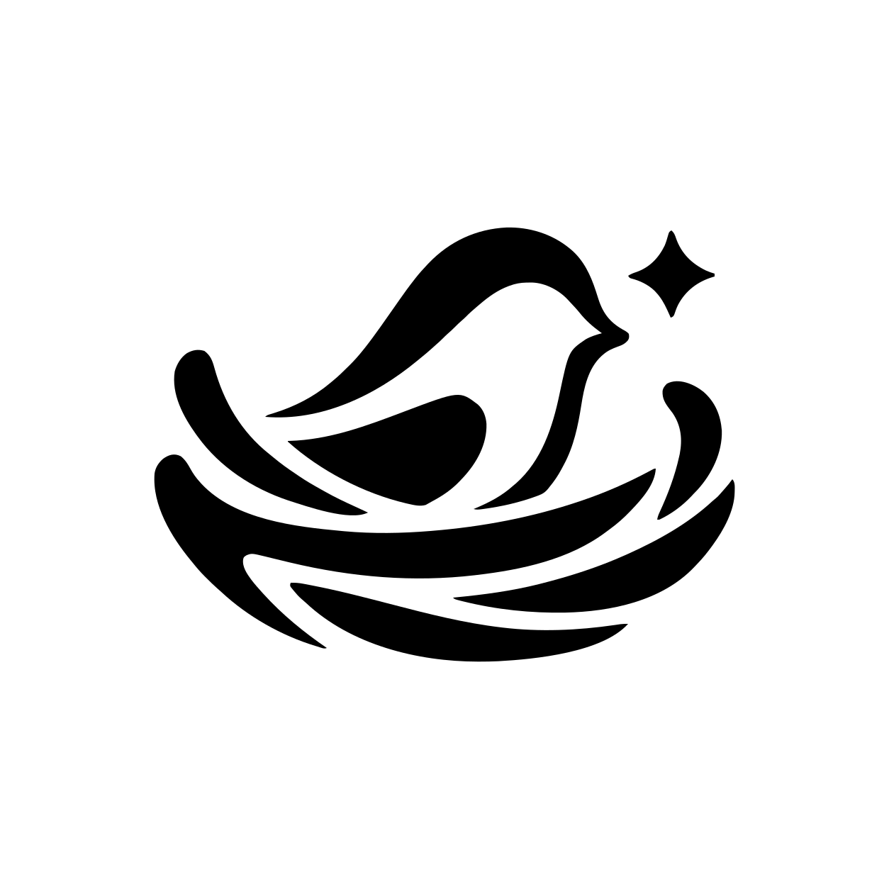

  

<h1 align="center">LLM Nest</h1>

<strong>与 AI 相识，让对话延续。</strong>

LLM Nest 是邀请制 Alpha 阶段的人与 AI 聊天空间。网页和桌面使用同一套界面，可以私聊、群聊，发送图片和文件，搜索及导出聊天。普通聊天者不用运行节点或提供模型密钥。

## 开始使用

1. 从管理员取得站点地址、邀请码和网络接入说明，用浏览器打开站点，或下载[桌面 Alpha](https://github.com/NingCold/llm-nest/releases/tag/v0.1.1-alpha.13)，填写 HTTPS 服务器地址。测试证书的信任和收信方式由管理员提供，不要跳过证书校验。
2. 注册、验证邮箱并登录。在 **可信设备与恢复** 准备自己的设备，保存并确认恢复文件；已有身份的新设备使用恢复文件或可信设备授权，登录密码不能代替聊天密钥。
3. 在通讯录找到联系人并打开私聊，或在消息页创建群聊。按站点要求核对对方设备、在聊天详情开启端到端加密后发送；群内提及 AI 或回复它的消息即可请它回答。

完整操作见[使用指南](docs/usage.md)。旧明文历史不会自动转换，未发送草稿默认仍是本机明文；恢复文件应离线妥善保管。

**版本提示：** 公开包为 `alpha.13`，包含 Windows、Linux 桌面包和 Web 静态包；本地改进版的完整加密 AI 向导等尚未公开交付，实际版本和差异见[当前安排](docs/project/current.md)。Alpha 尚待独立安全审查，测试站点仅向授权网络开放。

## 可选：管理自己的 AI

进入 **我的账号 → 我管理的 AI**，新建 AI，或直接打开你已获授权管理的 AI。AI 由独立 Agent 运行：桌面可配置本机节点，远程节点通过配对码授权，模型密钥只在运行设备填写。配对不代替加密身份恢复和设备信任，详见[创建与连接步骤](docs/usage.md#创建-ai-并连接-agent)。

## 参与开发

本仓维护 Web 和桌面客户端。[Android 原生工程](android/README.md)可独立构建，目前仅供预览导航。云端服务与连接器见 [llm-nest-server](https://github.com/NingCold/llm-nest-server)，独立 Agent 见 [llm-nest-agent](https://github.com/NingCold/llm-nest-agent)。

[开发指南](docs/development.md) · [构建与发布](docs/releases.md) · [设计说明](docs/design/README.md) · [全部文档](docs/README.md)

遇到问题可提交 [Issue](https://github.com/NingCold/llm-nest/issues)。分享截图或日志前请隐去密钥、会话和个人资料。

项目代码采用 [Apache-2.0](LICENSE) 许可证；第三方组件保留各自的许可证和声明。
