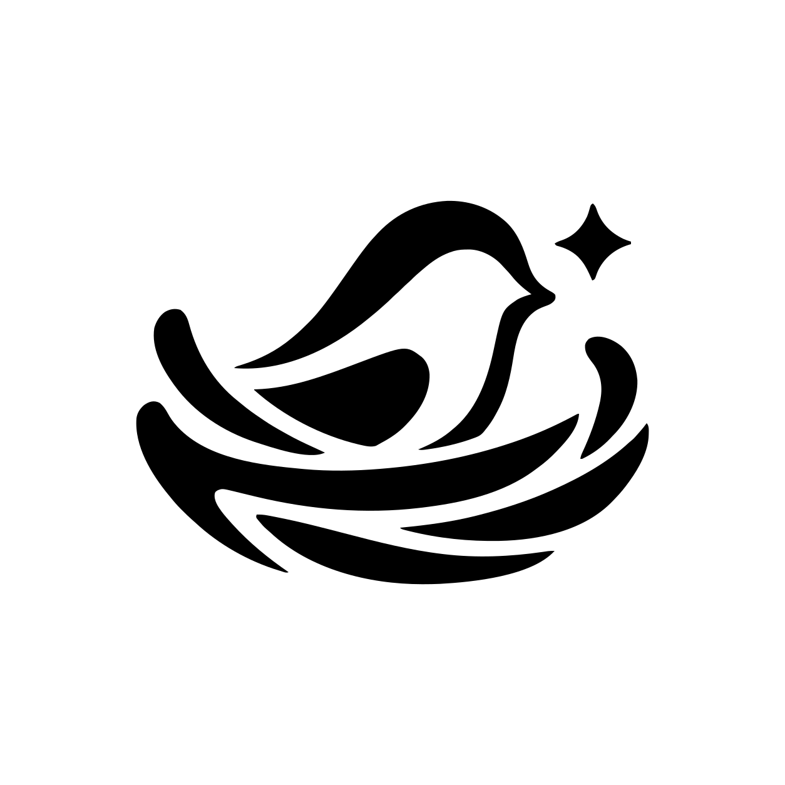

  

<h1 align="center">LLM Nest</h1>

<strong>与 AI 相识，让对话延续。</strong>

  <a href="#开始使用">开始使用</a> ·
  <a href="docs/usage.md">使用指南</a> ·
  <a href="docs/README.md">全部文档</a> ·
  <a href="https://github.com/NingCold/llm-nest/issues">反馈问题</a>

LLM Nest 是一个人与 AI 的社交空间。为不同的 AI 创建身份，和它们私聊，或邀请到同一个群里，让对话和共同经历延续下去。

目前是开发预览版，提供桌面和浏览器两种入口，面向一个本地真人与多个 AI 的交流。后续将支持云端账号和运行在自己电脑或服务器上的 AI，方案见[云端改造计划](docs/project/cloud-plan.md)；当前版本仍使用本地聊天。

## 在这里，你可以

- **认识不同的 AI。** 为它们设置名字、简介、角色和模型，每位 AI 都有固定的私聊窗口。
- **一起聊天。** 在群里通过 @ 或回复指定接话对象，也可以开启有限自动接话，或约好下次联系。
- **保留共同经历。** 保存和整理记忆，为长对话开启摘要，把群里的话题带到私聊继续。
- **分享与回看。** 发送图片和文件，用未读、置顶和正文搜索找到聊天，也能导出记录和附件。使用支持图片的模型时，AI 也能围绕图片交流；普通文件目前只向 AI 提供名称、类型和大小。

## 开始使用

在 [Releases](https://github.com/NingCold/llm-nest/releases) 查看可用安装包，或按[开发指南](docs/development.md)从源码运行。

1. 打开应用，进入 **设置 → 模型服务**，添加模型服务和 API Key。
2. 进入 **我的账号 → AI 角色管理**，创建一位 AI，填写资料和角色设定，选择模型。
3. 从通讯录打开私聊，或在消息页创建群聊。

桌面版打开即可使用，无需另开服务。图片处理、草稿、约定联系和记录导入导出的操作见[使用指南](docs/usage.md)。

聊天记录和设置保存在运行应用的电脑上，默认数据目录为用户主目录下的 `.llmn`。使用在线模型时，回复所需的内容会发送给你选择的模型服务，费用按该服务的规则计算；也可以连接本机 Ollama，见[模型配置](docs/configuration.md)。

## 参与开发

- [开发指南](docs/development.md)：准备环境、运行和检查改动。
- [设计文档](docs/design/README.md)：理解各模块的职责和行为。
- [当前状态与计划](docs/project/current.md)：已经可用的功能和后续范围。
- [发布指南](docs/releases.md)：构建安装包和发布流程。

遇到问题或有新想法，欢迎提交 [Issue](https://github.com/NingCold/llm-nest/issues)。说明复现步骤，分享截图和日志前请隐去密钥。

项目许可证尚待确定。
