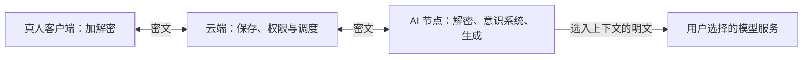

# 端到端加密方案

[设计入口](README.md) · [存储与迁移](storage.md) · [意识系统](consciousness.md) · [当前安排](../project/current.md)

**状态：聊天加密规则 D1–D9 已全部确认，尚未实现。** 用户确认了下文的九项产品规则，同时要求暂不实现。本文维护已确认的加密方向、功能影响和建议实施顺序；协议实现尚未选定。末节的 AI 资料云端密文同步方案仍待讨论，不能将其建议当作已采纳约定。当前程序继续采用现有本地资料归属与在线管理行为。

## 目前做到哪里

客户端与云端使用 HTTPS，Agent 使用 WSS。云端 PostgreSQL 的聊天正文是可直接读取的文本，附件目录保存原始字节，没有应用层内容加密；本轮未核验云厂商磁盘是否另有加密。角色、模型参数、记忆和摘要主要在节点 SQLite；在线管理正文虽不写入云端数据库或日志，仍经过云端明文转发。

邮箱登录、节点配对和成员权限控制“谁能请求数据”，目前没有独立的设备解密授权。只读查看 AI 账号会向其管理员返回该 AI 有权访问的聊天。以上仍是当前可用行为，不能用本文对外声称已经端到端加密。

## 目标和边界

已确认的方向是由真人客户端和 AI 节点负责加解密，云端保存、同步密文，不能直接解开聊天、附件及管理正文。登录凭据、聊天密钥、节点凭据和模型 Key 分开管理。磁盘、备份和本机缓存的加密作为配套保护，不能代替端到端加密。

这个目标不承诺隐藏全部通信关系。为保留现有社交和调度行为，云端继续保留账号、成员、消息所属窗口、发送者、时间、顺序、密文大小、结构化提及/回复目标、任务状态、额度，以及来源 ID/版本。模型参数、正文、附件文件名与解密材料不放入这些公开字段。D1 已接受这一元数据范围，具体字段与端点验证方式在协议选型时落实。

授权端必须能验证发送设备及消息完整性，并将窗口、消息、修订和附件关联纳入验证，不能仅对正文做一次加密。云端改掉一个字段或替换公钥，不能静默成为新的可信身份。新增设备、撤销设备和群成员变化需要端点可验证的授权更新。

AI 节点运行时会接触明文；使用外部模型时，选中的上下文仍会发送给该服务。节点设备控制者也可能读取运行内存。端到端加密不保护内容免受获授权接收者复制，不能追回旧节点、旧管理员或退群成员已经取得的内容。

网页仍可作为加密客户端，但当前 Web 代码由平台提供。恶意平台如果替换网页脚本，可能读取解密材料或显示中的正文。首次身份核验、可信设备确认和密钥变化提示要纳入方案；更强的代码信任需要可独立验证的客户端构建及更新渠道。首轮不宣称能够抵御平台任意投递恶意 Web 代码。桌面和节点同样需要信任其软件及更新来源。

## 从 SimpleX 参考什么

以下根据 2026-10-23 查阅的官方资料整理，仅参考可适用的设计，不表示我们采用其全部协议或隐私承诺。

| SimpleX 的做法 | 对 LLM Nest 的启发 |
| --- | --- |
| SMP 中继以队列投递消息，收到确认后删除已投递消息，并限制未投递消息保存时间 | 明确区分“投递队列”和“长期历史”；我们计划保留云端密文历史，不能照搬其删除方式。[SMP 协议](https://github.com/simplex-chat/simplexmq/blob/stable/protocol/simplex-messaging.md#acknowledge-message-delivery) |
| 使用 Double Ratchet，按连接组织通信，并提供独立渠道交换连接信息的机制 | 参考身份确认、会话密钥更新和撤销，不能用一把永久窗口密钥代替成熟会话协议。[架构说明](https://github.com/simplex-chat/simplexmq/blob/stable/protocol/overview-tjr.md) |
| 聊天库可加密导出、迁往另一设备；数据库副本不能作为多个独立活动端随意并用 | 历史资料、设备身份和执行状态分开迁移。不能直接复制正在运行的节点数据库来实现多设备。[设备迁移说明](https://simplex.chat/docs/guide/chat-profiles.html#move-your-chat-profiles-to-another-device) |
| 提供联系人安全码核验，以及聊天库口令管理 | 登录和授权节点之外，需要可验证的设备身份；本机加密不能只保护网络链路。[隐私与安全设置](https://simplex.chat/docs/guide/privacy-security.html) |

SimpleX 的个人聊天以设备存储为主、SMP 队列不作为长期聊天档案；其公开频道等功能另有存储规则。我们保留云端账号、通讯录、群管理和长期密文历史，不把“没有全局用户标识”照搬成项目目标。SimpleX 文档里的 Agent 是通信协议组件，不等同于我们的 AI 执行节点。

协议选型应同时比较 SimpleX 的会话处理、[MLS 群组协议](https://www.rfc-editor.org/rfc/rfc9420.html)和成熟实现对本项目的适配程度；历史恢复可参考 [Matrix 加密密钥备份](https://spec.matrix.org/latest/client-server-api/#server-side-key-backups)。它们解决的问题不完全相同，不把几段算法拼成自制协议，也不因参考某项目就宣称继承其审计结果。最终选型在规则确认后的可运行原型中完成。

## 身份、历史和恢复怎样衔接

账号 ID 继续稳定；设备持有自己的密钥。真人可有多个可信客户端，AI 首轮仍只有一个有效执行节点。新设备需要已有可信设备或独立恢复材料确认，平台登录和修改账号密码不自动给予历史解密能力。无法可信确认的身份变化应显式提示，不能自动降级为明文。

聊天历史需要长期可恢复，因此要另行设计加密的历史解密材料备份。活跃会话可以更新并删除旧会话状态，但只要仍保留可读历史或恢复材料，相应历史就仍受这些材料安全性的影响；不能同时承诺无限恢复和彻底销毁所有历史解密能力。服务器可保存密钥备份密文，解密它的恢复密钥由用户保管，不与数据库一起保存明文。

更换 AI 节点时，新节点生成自己的设备身份；获授权端转交允许恢复的历史解密材料，重新授权执行并更新后续通信密钥。旧节点失去未来执行和接收资格，但其已取得的明文无法追回。只迁移聊天解密材料及资料，不把旧活动会话状态、节点凭据、预算和未完成调用一起克隆。模型 Key 在新节点重新配置。

若全部可信设备和恢复材料均丢失，云端密文仍可能存在，但无法承诺读回历史。其他参与者只有在仍持有材料且规则允许时才可能协助；不能把这种可能性当成必有恢复路径。正常换机应先验证恢复资料，再撤销旧设备。

D5 已确认继续保留完整群历史规则。新成员需要通过获授权端取得可分享的历史解密材料；这一步不等于服务器写入一条成员记录。没有可用分享端或恢复材料时，应显示历史暂未恢复。退出、移除及设备撤销后更新未来密钥；重新加入不恢复已失效的群引用或节点记忆。

AI 管理员目前可以管理节点、改角色/模型并只读查看 AI 的聊天，这意味着他们是该 AI 内容的受信任管理者。即使隐藏“查看聊天”按钮，只要仍可接管节点或改变其运行方式，就不能承诺对这些管理员保密。若需要只维护运行但不能接触内容的角色，必须重新收窄实际设备和配置控制权，不能仅加一个界面权限开关。

## 对现有功能的影响

| 功能 | 需要调整 | 保留的行为 |
| --- | --- | --- |
| 私聊、群聊、账号和通讯录 | 发送端加密，授权接收端解密；密钥授权与账号权限分别验证 | 稳定账号、唯一私聊、各群独立、消息/通讯录入口 |
| 多设备、草稿及只读账号查看 | 设备确认、密钥恢复、本机加密缓存；管理员查看也必须取得相应解密授权 | 草稿按服务器/账号/窗口隔离，不自动发送；查看不代发、不改已读 |
| 历史、搜索和列表预览 | 服务端不能检索正文；客户端同步解密并建立本地索引，展示未同步范围 | 完整历史仍保存在云端；置顶、个人读态和按 ID 定位继续可用 |
| 图片、文件及缩略图 | 字节和文件名加密；服务端只查密文上限；接收端重新验证真实格式、大小和解码限制 | 图片/文件原有明文限制继续成立，另计加密开销；不把文件正文自动交给模型 |
| 可读导出 | 在授权客户端解密后生成 Markdown/JSON/附件包；原生保存仍由桌面处理 | 导出完整选定窗口，继续复核权限，不展开其他窗口 |
| AI 材料读取、摘要和群接续 | 节点先解密再选材；引用只暴露必要标识，引用内容在有权的端读取 | 必要来源不得静默丢弃；记忆、摘要仍按 AI 与窗口隔离 |
| 角色、模型与意识在线管理 | 请求、响应和错误中的敏感内容都须端到端保护；仅“不落云端库”不够 | 实际管理员身份及来源权限仍检查，模型 Key 不上传 |
| 接话、暂停、免打扰与额度 | 云端根据保留的结构信息调度，约定正文加密给授权端；具体语义由端点验证 | 合并输入、同窗串行、云端次数与节点预算、明确开始确认继续成立 |
| 流式生成、检查点、幂等 | 流式片段、累计草稿、最终结果和节点回执中的敏感内容都加密；重试保留同一冻结密文 | 不能因随机重加密造成同请求指纹冲突；已开始且结果未知的调用不重做 |
| 来源失效、修订和遗忘 | 保留来源 ID/版本与授权变更，端点验证来源更新并清理依赖材料 | 重连先处理失效；旧备份不能自动复活已遗忘资料；不能保证删除他人已有副本 |
| 外部 Agent 接入 | 连接器承担协议兼容和加密消息处理，外部端按统一契约接入 | 不要求外部 Agent 使用自带 SQLite；不支持加密的端不能进入加密窗口或触发明文回退 |

加密不能保证服务器一定投递事件，也不能保证恶意服务器及时告知撤回或停用。已有版本、权限和来源检查继续有用，但要区分正常服务下的一致性与端点能够独立验证的事实；不能把当前 PostgreSQL 事务保证直接称为抵御恶意服务器的密码学保证。

## 建议实施顺序

聊天加密规则已获确认，实施仍按用户要求暂不开始。新的加密工作线不改写已经完成的云端第 0–5 步，也不自动把候选功能加进来。按完整可体验的批次推进，每批内包含前后端、验证和文档，不逐个升级成产品阶段。

| 顺序 | 范围 | 完成条件 |
| --- | --- | --- |
| 0. 确定规则（当前） | D1–D9 已确认；继续讨论 AI 资料归属、离线管理及换节点语义 | 所有产品取舍明确记录；没有待定的密钥恢复或管理员信任边界；此阶段不实现 |
| 1. 私聊与换机闭环 | 选定成熟协议实现，打通真人客户端与 AI 节点、文字/附件、流式回复、设备确认、恢复和换节点；包含被使用的管理与意识链路加密 | 平台未收到这些内容的明文；两个端能聊天，旧节点撤销后未来消息安全，新节点可恢复历史；无明文降级 |
| 2. 完整社交体验 | 群聊、成员变更、完整群历史分享、多客户端、搜索导出、群引用、约定与管理；落实已确认的 AI 资料存储方案 | 当前首版核心功能可在加密模式使用，来源失效、权限变更和恢复行为与约定一致 |
| 3. 存量切换与试用 | 用户端处理旧聊天、附件和节点资料，备份后预览并迁移；标明加密范围、版本要求与旧明文备份清理策略 | 迁移可核对、可恢复、不重复生成；旧资料不会被误称从未明文存储；独立审查和实际设备试用完成 |

协议选择由实现兼容性、离线及乱序、群规模、历史恢复、许可和维护情况决定。密码学实现采用现有可靠库，不由用户选择底层算法参数。正式启用前，重点验证密钥替换、设备撤销、群成员变化、失序重放、恢复和旧版本拒绝等实际边界，而非只验证双方能显示一条消息。

## 已确认的聊天加密规则

用户已明确采纳 **D1–D9 全部建议**，以下是后续实现必须遵守的产品规则；确认不代表实现已经启动或完成。AI 资料是否云端保存及其同步行为仍在下一节讨论，不包含在本次确认中。

| 编号 | 主题 | 已确认的规则与影响 |
| --- | --- | --- |
| D1 | 要保护内容，还是同时隐藏社交关系？ | 首轮让平台不能直接解密内容，保留云端账号、群成员、路由、来源版本和调度元数据 |
| D2 | 哪些聊天采用加密？ | 正式切换后私聊、群聊统一端到端加密，附件/约定正文/管理内容一起覆盖；旧端不能自动回退明文 |
| D3 | 长期历史如何恢复？ | 保留云端密文历史和加密的恢复资料，优先长期延续；接受历史安全依赖恢复材料的安全 |
| D4 | 新设备、忘记密码和全部设备丢失怎么办？ | 登录之外，由可信设备或独立恢复密钥授权；平台不托管可解密的恢复秘密；仅重置密码不能恢复旧聊天，全部材料丢失可能永久不可读 |
| D5 | 新群成员是否仍看完整历史？ | 沿用现有完整历史规则，新增历史密钥分享过程；分享条件未满足时显示历史暂不可读 |
| D6 | AI 管理员是否仍是完整受信任管理者？ | 保留现有全体管理员管理节点/角色/模型和只读查看的权限；授权可信管理员设备后可恢复该 AI 有权读取的历史，并向聊天用户说明。移除只限制未来权限，无法收回已有副本 |
| D7 | Web 与外部模型的信任边界是否接受？ | 保留 Web，但信任实际加载的客户端代码；AI 可将必要上下文发送给用户选择的模型服务，平台内容加密不覆盖模型处理过程 |
| D8 | 搜索与导出是否接受由客户端完成？ | 支持本地解密后的全历史搜索和导出，首次设备需同步，明确展示尚未索引的范围 |
| D9 | 旧明文数据怎样切换？ | 现存聊天由授权端加密迁入，先备份、预览和核对；切换后只走加密写入，旧明文备份列明位置及清理期限，实际删除前另行确认 |

## 待确认：AI 资料云端密文同步

**现行约定仍是节点主要保存角色、模型参数、记忆和摘要。** 用户提出可以利用端到端加密减少迁移负担；以下是可选方案，尚未改变现有存储与在线管理行为。

隐私取决于谁能解密，不只取决于文件放在哪台机器。角色和意识资料可以在用户端加密后存入云端，节点取得授权后下载、解密和使用。运行时仍需要本机工作副本，云端密文也不能替代密钥恢复。

| 方式 | 换节点和恢复 | 管理体验 |
| --- | --- | --- |
| 主要存在节点（现状） | 从旧节点导出，或恢复用户自己的资料备份 | 节点离线时不能查看、修改内部资料 |
| 节点为主，云端保存加密备份 | 新节点恢复最近一次成功备份，可能缺最后一段更改 | 仍以节点保存确认作为成功，备份不是在线协作存储 |
| 云端保存可同步的密文资料，节点保留工作副本（倾向推荐） | 新节点经可信授权恢复最新已同步资料；旧节点未上传部分仍可能缺失 | 获授权客户端可读密文并本地解密；是否允许节点离线时保存新设定需要明确 |

建议采用第三种方式：**云端持久保存当前已确认的密文资料，节点保留用于工作的本地副本。** 每份资料归属稳定 AI 账号及其窗口，不归属某台电脑。以下是新的建议，仍待用户确认，尚未替代“节点保存才成功、离线不排队”的现行实现。

### 哪些资料同步

| 内容 | 建议处理 |
| --- | --- |
| 角色设定、模型选择及生成参数 | 云端保存密文版本；管理员的可信客户端编辑，节点验证后应用 |
| 显式记忆、来源标识、遗忘状态 | 按 AI 与窗口保存密文及必要的权限/版本信息；沿用当前成员维护范围 |
| 各 AI 的窗口摘要及摘要设置 | 按 AI、窗口和分段保存密文；当前运行节点负责生成，管理入口沿用现有权限 |
| 模型 API Key、provider 地址及本机凭据配置 | 留在节点，新设备自行配置；密文同步不改成官方托管模型秘密 |
| 设备私钥、节点连接凭据、调用检查点和本机预算 | 留在各设备，不复制成另一个活动实例；云端原有任务开始确认、次数记录继续保留 |
| 历史解密材料和资料恢复材料 | 独立加密备份、按可信设备授权，不混在普通资料正文里 |

按资料条目或分段同步，不反复上传整个 SQLite。已有确认版本、待提交修改、本机已应用版本分开记录；节点未上传的改动不能显示为云端已保存。公开版本和权限信息可供云端检查，正文、模型参数和具体错误内容只供获授权端解密。

角色档案、窗口记忆和内部摘要需要不同的授权范围。群成员维护某个 AI 的本群记忆，不因此取得该 AI 全部私聊资料的解密能力；AI 管理权和原文访问范围继续按现有规则检查。外部 Agent 可以继续使用自己的内部存储，密文资料同步是可选接入能力。

### 离线修改和保存状态

| 情况 | 建议行为 | 界面反馈 |
| --- | --- | --- |
| 客户端、云端和节点均在线 | 客户端加密提交，云端确认保存，节点取得并验证当前版本后应用 | 先“已保存，待节点应用”，收到当前版本回执后显示“节点已应用” |
| 客户端在线，节点离线 | 仍可读取已有授权的密文资料并在本机解密；保存新版本，节点重连后再应用 | “已保存，节点离线”；不把密文保存称为模型配置已验证 |
| 客户端也断网 | 已解锁且有缓存的资料可编辑；点击保存后在本机持久保存待同步命令，恢复连接后尝试提交 | “已保存在此设备，待同步”；只有本机缓存的资料可供查看 |
| 保存请求发出但结果未知 | 查询原请求结果，必要时重发同一冻结命令和密文，不另建一次修改 | “保存结果待确认”；节点回执不能替代云端保存确认 |
| 资料已被其他人修改，或权限/来源已变化 | 重新核对；冲突时保留本机编辑，展示当前内容供选择，不静默覆盖 | “需要处理冲突”或具体权限/来源提示 |

恢复联网后的提交仅针对用户已经点击保存的意图；未保存输入仍是本机草稿。这是资料同步的建议，不改变聊天草稿不自动发送、聊天发送结果未知只手动重试的现行规则。首次登录且没有可信设备授权或恢复材料时，即使能下载密文也不能查看或编辑正文。

云端不解密资料，因此只能确认身份、范围、版本、来源标识、大小及密文已经持久保存。客户端先校验自己能确定的格式；节点检查本机是否配置所选模型、参数是否适配和密钥是否齐备，真正调用是否成功仍以模型服务返回为准。新节点不支持所选模型时显示“已保存，无法应用”，暂停该 AI 的新运行，等待修正或明确撤回该修改；不静默改模型或继续以旧配置产生新回复。

普通角色和模型修改只用于新运行，已经开始的回复保持原快照。节点在开始下一次运行前必须取得并确认所需的最新已保存版本；应用失败不覆盖上次可用的本机快照。管理员若决定恢复旧设定，应将其明确保存为新的版本。多个离线修改以当前最新保存的有效资料为准，不把所有中间角色设置逐个执行成操作队列；旧版本回执不得把后来版本显示为已应用。

不同条目独立更新；同一条目使用预期版本检查。两位管理员同时改同一角色或同一条记忆时，后提交者需处理冲突，不自动合并正文。这类条件更新可参考 [HTTP If-Match 的并发修改语义](https://www.rfc-editor.org/rfc/rfc9110.html#section-13.1.1)，具体接口沿用项目的请求去重和版本机制，不预建通用协作框架。

### 记忆、摘要和遗忘的特殊处理

新增记忆供新运行读取；修改已有记忆、遗忘或来源失效时，云端在确认变更的同一事务更新相关材料版本，停止依赖旧版本的工作并拒绝迟到提交。云端不需要读取记忆正文即可执行这一限制。节点重连先处理失效，再同步内容，不能先用缓存回复、随后再删除。

遗忘成功应分别表达“平台已停用这条记忆”和“节点副本已清理”。节点离线时可以完成前者，不能声称已删除所有设备副本。客户端自己也断网时，只能保存待同步的遗忘意图；远端节点尚不知道该请求，不能显示全局已遗忘。

遗忘标记和资料版本优先于旧备份，恢复或补传不能把原条目改回有效。需要重新记住时使用明确的新操作；遗忘显式记忆仍不等于删除聊天原文或保证模型以后不从原文再次得知同一事实。已经发给模型或被外部端保存的明文无法追回。

节点产生摘要时，先持久保存结果，再同步密文；云端确认且来源仍有效后，才标为已同步、允许新运行将其作为正式资料。网络中断时保留待同步结果，不重复调用模型；来源已失效时清理结果。回复片段、任务开始与结果恢复继续遵守既有“不重做已开始或结果不明调用”的规则。

### 更换运行节点

正常换节点建议采用一次明确切换：

1. 新设备先准备程序、本机模型配置和新设备密钥，检查可运行条件；此时不取得第二个并行发言资格。
2. 旧节点停止领取该 AI 的新工作，等待当前调用结束，或由管理员明确停止；把允许保留的资料同步到云端，确认没有待上传变更。
3. 管理员确认新设备身份并转交获授权的解密材料。云端更新绑定版本，撤销旧节点的读写与发言资格，登记新节点；后续密钥按 D1–D9 更新。
4. 新节点恢复历史及最新密文资料，先同步来源失效和遗忘标记，再验证模型和资料版本，返回与新绑定对应的应用确认。
5. 确认达到当前资料版本后恢复接话。切换期间出现的更新也必须补齐；不因换节点重放已开始或结果不明的模型调用。云端未来约定仍按原授权和有效期处理，换绑本身不触发发言。

切换后新节点尚未准备好时，显示“恢复中”或明确错误，保持该 AI 暂不可运行；不暗中重新启用旧节点。既有账号、私聊、群成员和云端历史不变。

旧节点损坏或丢失时，管理员可明确强制切换：从最近已同步的云端资料和可用恢复材料恢复。旧节点尚未上传的内容可能丢失，应显示最后同步状态，不能承诺零损失。缺少解密材料时按 D4 处理，不能通过重置登录密码绕过。

旧节点后来重新上线，旧绑定也不能再上传资料或发言。若找回未同步内容，只能作为待导入资料交给管理员预览，核对版本、来源与遗忘状态后选择；不能让旧数据库直接覆盖新节点。新绑定确认之前同样复核管理员权限，防止离线期间已撤销的授权被恢复。

### 密钥和资料恢复

建议 AI 的恢复能力独立于某一台运行节点。创建时由初始管理员的可信设备建立恢复资料，并提供离线备份；其他现有管理员按 D6 获得可信设备授权后也可协助恢复，普通管理员仍不能增删管理员名单。云端只保存面向获授权端加密的恢复材料，不持有可直接使用的恢复秘密。

不将登录密码直接用作资料主密钥，不把恢复密钥塞进聊天、普通导出或节点命令参数。移除管理员或设备时更新未来资料的授权与密钥，旧授权不能借旧备份重新取得新密钥；已解密的旧资料仍无法收回。恢复材料也有版本，需要更新相应备份。

这借鉴了 [Matrix 的加密秘密存储](https://spec.matrix.org/latest/client-server-api/#secret-storage)与[加密密钥备份](https://spec.matrix.org/latest/client-server-api/#server-side-key-backups)的分工思路，但上面的离线应用和节点切换规则是本项目的建议，不是直接采用 Matrix 数据格式。本机自动启动需要设备能够解锁自己的工作资料，不要求每次回复都等待真人输入口令。

### 本轮仍待确认的同步规则

以下 S1–S5 与已确认的 D1–D9 分开，均是本轮讨论建议，尚未采纳、尚未实现。

| 编号 | 建议 |
| --- | --- |
| S1 | 角色、模型选择/参数、显式记忆、各 AI 窗口摘要采用云端密文同步，节点保留工作副本；本机秘密与执行状态不随资料同步 |
| S2 | 节点离线允许保存密文，明确区分已保存与已应用；客户端断网时保存本机待同步意图，恢复连接尝试原命令，冲突不覆盖；无效新配置暂停新运行 |
| S3 | 已确认的记忆修改、遗忘和来源失效立即限制旧版本执行与提交；节点稍后清理；旧备份及旧节点不能自动复活条目 |
| S4 | 正常换节点先停接新工作并同步，再撤销旧绑定、恢复新节点；旧节点损坏时明确强制切换，接受尚未同步资料可能缺失，不重放旧调用 |
| S5 | 恢复能力不依赖唯一节点；初始管理员建立恢复资料，可信管理员设备可获授权恢复；云端不持有可直接解密的恢复秘密 |
