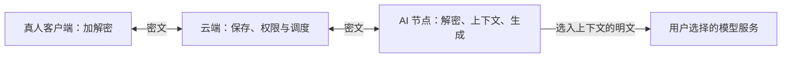

# 端到端加密方案

[设计入口](README.md) · [存储与迁移](https://github.com/NingCold/llm-nest-server/blob/main/docs/design/storage.md) · [意识系统](https://github.com/NingCold/llm-nest-agent/blob/main/docs/design/consciousness.md) · [当前安排](../project/current.md)

## 哪些内容受保护

已启用加密的私聊和群聊由客户端与节点加解密，云端保存密文，角色、模型选择及参数、显式记忆和各 AI 的窗口摘要也可以作为密文资料保存；节点保留运行所需的工作副本。客户端与云端仍使用 HTTPS，Agent 使用 WSS。模型 Key、节点凭据和设备私钥不放入云端资料。

登录与解密授权分开。新设备需可信设备授权或恢复文件，AI 管理员只读查看同样需要解密能力。内网试用站开启了 `CLOUD_REQUIRE_ENCRYPTION=true`，拒绝新的明文内容；发送前须准备可信设备、恢复材料并开启聊天加密。此开关不转换旧记录、附件或备份，需要转换时仍由授权端显式操作。日常恢复、历史和强制加密的实际验证见[验收记录](../validation/records.md)。

本机 SDK 密钥库使用独立口令或节点私有目录中的解锁材料。普通聊天草稿、节点工作资料和运行检查点仍可能包含本机明文。恢复文件含解密秘密，须与普通聊天导出分开保管。

## 本机锁定与自动解锁

登录会话与 SDK 解锁分别管理。“保持登录 30 天”只保留账号会话，规则见[账号设计](https://github.com/NingCold/llm-nest-server/blob/main/docs/design/accounts.md#登录会话与本机解锁)。已有本机设备尚未解锁时显示独立玻璃锁屏，其背景仅为占位框架，不渲染聊天正文。锁定前保存草稿，随后关闭 SDK、卸载聊天组件和订阅并清理聊天状态；只保留登录账号及导航位置。本机 Agent 继续独立运行。首次创建身份及恢复设备仍在“可信设备与恢复”页面进行，锁屏也能直接进入恢复入口。

“在此设备自动解锁”默认关闭。只有成功手动解锁现有 SDK 密钥库、设备已可信且已确认恢复文件后，才能再次输入本机口令确认开启，绝对有效 30 天。Windows 通过当前用户 DPAPI 保护本机口令；Web 在 IndexedDB 保存不可导出的 AES 密钥及封装后的口令，两者都留在当前浏览器资料中。非 Windows 原生端暂不开放自动解锁，也未接入生物识别或 WebAuthn。

开启自动解锁适合自己的设备。Windows 保护依赖当前操作系统用户；Web 的密钥与封装口令均在同一浏览器资料内，持有并能使用这份资料的人可能解锁，不能据此承诺抵御本机资料持有人。30 天到期由应用检查并清理材料，不意味着材料在密码学上自动失效。

手动锁定会暂停自动解锁，暂停状态跨刷新和重启保留；下次成功手动解锁后恢复。关闭自动解锁或退出账号会清除自动材料，不删除原 SDK 密钥库，也不替换账号身份。保留的登录与自动解锁可以减少日常重复输入，不能代替新设备授权、恢复文件或联系人指纹核验。具体存储与调用约定见[加密契约](https://github.com/NingCold/llm-nest-server/blob/main/docs/design/crypto-contract.md#本机解锁与自动材料)。版本与安装状态见[当前安排](../project/current.md)。

## 内容、元数据与信任

云端保留账号、成员、路由、发送者、时间、顺序、密文大小、提及/回复目标、任务、额度和来源 ID/版本。正文、附件文件名、模型参数与解密材料不放入公开元数据。设备身份、消息完整性、窗口、修订与附件关联由授权端验证；新增或撤销设备、群成员变化需要相应授权与密钥更新。

AI 节点和选定的模型服务会接触必要明文，AI 管理员仍是受信任的内容管理者。撤权限制未来访问，已取得的明文或密钥无法追回。Web 用户信任实际加载的网页代码，桌面与节点用户信任其程序和更新来源。

保留云端密文历史和加密密钥备份，长期恢复依赖恢复材料安全。平台登录或重置密码不授予解密能力；全部可信设备和恢复材料丢失时，历史可能永久不可读。换机应先验证恢复，再撤销旧设备。

2026-10-23 的选型参考了 SimpleX 的[身份核验与迁移](https://simplex.chat/docs/guide/privacy-security.html)、[MLS](https://www.rfc-editor.org/rfc/rfc9420.html) 和 Matrix，最终采用官方 Matrix SDK，适配多设备、长期历史与[密钥备份](https://spec.matrix.org/latest/client-server-api/#server-side-key-backups)。具体版本和发送者验证见[加密契约](https://github.com/NingCold/llm-nest-server/blob/main/docs/design/crypto-contract.md)。

## 实施安排

同机聊天、私聊与 AI 资料加密、完整社交接入和存量切换均已完成，内网试用已要求新内容加密。各批结果见[验收入口](../project/completed.md#已完成的改造与验收入口)，0.1.2 的复审及联调范围见[验收记录](../validation/records.md#012-稳定版)，平台缺口见[待验收](../project/backlog.md#待验收)。

## 已确认的聊天加密规则

以下 **D1–D9** 与资料同步的 **S1–S5** 是已采纳的产品规则。

| 编号 | 主题 | 已确认的规则与影响 |
| --- | --- | --- |
| D1 | 要保护内容，还是同时隐藏社交关系？ | 首轮让平台不能直接解密内容，保留云端账号、群成员、路由、来源版本和调度元数据 |
| D2 | 哪些聊天采用加密？ | 正式切换后私聊、群聊统一端到端加密，附件/约定正文/管理内容一起覆盖；旧端不能自动回退明文 |
| D3 | 长期历史如何恢复？ | 保留云端密文历史和加密的恢复资料，优先长期延续；接受历史安全依赖恢复材料的安全 |
| D4 | 新设备、忘记密码和全部设备丢失怎么办？ | 登录之外，由可信设备或独立恢复密钥授权；平台不托管可解密的恢复秘密；仅重置密码不能恢复旧聊天，全部材料丢失可能永久不可读 |
| D5 | 新群成员是否仍看完整历史？ | 沿用现有完整历史规则，新增历史密钥分享过程；分享条件未满足时显示历史暂不可读 |
| D6 | AI 管理员是否仍是完整受信任管理者？ | 保留现有全体管理员管理节点/角色/模型和只读查看的权限；授权可信管理员设备后可恢复该 AI 有权读取的历史，并向聊天用户说明。移除只限制未来权限，无法收回已有副本 |
| D7 | Web 与外部模型的信任边界是否接受？ | 保留 Web，但信任实际加载的客户端代码；AI 可将必要上下文发送给用户选择的模型服务，平台内容加密不覆盖模型处理过程 |
| D8 | 搜索与导出是否接受由客户端完成？ | 支持本地解密后的全历史搜索和导出，首次设备需同步，明确展示尚未索引的范围 |
| D9 | 旧明文数据怎样切换？ | 现存聊天由授权端加密迁入，先备份、预览和核对；切换后只走加密写入，旧明文备份列明位置及清理期限，实际删除前另行确认 |

## AI 资料云端密文同步设计基线

已启用加密的 AI 将角色、模型设置、记忆和摘要作为密文同步到云端。每份资料归属 AI 账号及其窗口；获授权的节点保留运行所需的工作副本。节点离线时可以先保存密文，等它上线后再验证并应用，界面分别显示这两个状态。旧的未加密档案仍通过在线节点管理，迁入加密前须明确转换；已启用加密的节点拒绝明文管理请求。

### 哪些资料同步

| 内容 | 处理方式 |
| --- | --- |
| 角色设定、模型选择及生成参数 | 云端保存密文版本；管理员的可信客户端编辑，节点验证后应用 |
| 显式记忆、来源标识、遗忘状态 | 按 AI 与窗口保存密文及必要的权限/版本信息；沿用当前成员维护范围 |
| 各 AI 的窗口摘要及摘要设置 | 按 AI、窗口和分段保存密文；当前运行节点负责生成，管理入口沿用现有权限 |
| 模型 API Key、provider 地址及本机凭据配置 | 留在节点，新设备自行配置；密文同步不改成官方托管模型秘密 |
| 设备私钥、节点连接凭据、调用检查点和本机预算 | 留在各设备，不复制成另一个活动实例；云端原有任务开始确认、次数记录继续保留 |
| 历史解密材料和资料恢复材料 | 独立加密备份、按可信设备授权，不混在普通资料正文里 |

按资料条目或分段同步，不反复上传整个 SQLite。已有确认版本、待提交修改、本机已应用版本分开记录；节点未上传的改动不能显示为云端已保存。公开版本和权限信息可供云端检查，正文、模型参数和具体错误内容只供获授权端解密。

角色档案、窗口记忆和内部摘要需要不同的授权范围。群成员维护某个 AI 的本群记忆，不因此取得该 AI 全部私聊资料的解密能力；AI 管理权和原文访问范围继续按现有规则检查。外部 Agent 可以继续使用自己的内部存储，密文资料同步是可选接入能力。

### 离线修改和保存状态

| 情况 | 行为 | 界面反馈 |
| --- | --- | --- |
| 客户端、云端和节点均在线 | 客户端加密提交，云端确认保存，节点取得并验证当前版本后应用 | 先“已保存，待节点应用”，收到当前版本回执后显示“节点已应用” |
| 客户端在线，节点离线 | 仍可读取已有授权的密文资料并在本机解密；保存新版本，节点重连后再应用 | “已保存，节点离线”；不把密文保存称为模型配置已验证 |
| 客户端也断网 | 已解锁且有缓存的资料可编辑；点击保存后在本机持久保存待同步命令，恢复连接后尝试提交 | “已保存在此设备，待同步”；只有本机缓存的资料可供查看 |
| 保存请求发出但结果未知 | 查询原请求结果，必要时重发同一冻结命令和密文，不另建一次修改 | “保存结果待确认”；节点回执不能替代云端保存确认 |
| 资料已被其他人修改，或权限/来源已变化 | 重新核对；冲突时保留本机编辑，展示当前内容供选择，不静默覆盖 | “需要处理冲突”或具体权限/来源提示 |

恢复联网后的提交仅针对用户已经点击保存的意图；未保存输入仍是本机草稿。资料同步与聊天发送分开：聊天草稿不自动发送，未知发送只手动重试。首次登录且没有可信设备授权或恢复材料时，即使能下载密文也不能查看或编辑正文。

云端不解密资料，因此只能确认身份、范围、版本、来源标识、大小及密文已经持久保存。客户端先校验自己能确定的格式；节点检查本机是否配置所选模型、参数是否适配和密钥是否齐备，真正调用是否成功仍以模型服务返回为准。新节点不支持所选模型时显示“已保存，无法应用”，暂停该 AI 的新运行，等待修正或明确撤回该修改；不静默改模型或继续以旧配置产生新回复。

普通角色和模型修改只用于新运行，已经开始的回复保持原快照。云端路径在开始下一次运行前必须取得并确认所需的最新已保存版本；应用失败不覆盖上次可用的本机快照。管理员若决定恢复旧设定，应将其明确保存为新的版本。多个离线修改以当前最新保存的有效资料为准，不把所有中间角色设置逐个执行成操作队列；旧版本回执不得把后来版本显示为已应用。同机离线私聊只能知道本机持有的版本，其资料使用与重连规则见文末规则，不能把本机版本称为云端当前版本。

不同条目独立更新；同一条目使用预期版本检查。两位管理员同时改同一角色或同一条记忆时，后提交者需处理冲突，不自动合并正文。这类条件更新可参考 [HTTP If-Match 的并发修改语义](https://www.rfc-editor.org/rfc/rfc9110.html#section-13.1.1)，具体接口沿用项目的请求去重和版本机制，不预建通用协作框架。

### 记忆、摘要和遗忘的特殊处理

新增记忆供新运行读取；修改已有记忆、遗忘或来源失效时，云端在确认变更的同一事务更新相关材料版本，取消相关云端任务、通知在线节点并拒绝依赖旧版本的迟到提交。云端不需要读取记忆正文即可执行这一限制，但无法让断网节点即时获知变更。节点重连先处理失效，再同步内容，不能先用缓存继续在线回复、随后再删除。

遗忘成功应分别表达“平台已停用这条记忆”和“节点副本已清理”。节点离线时可以完成前者，不能声称已删除所有设备副本。客户端自己也断网时，只能保存待同步的遗忘意图；远端节点尚不知道该请求，不能显示全局已遗忘。

遗忘标记和资料版本优先于旧备份，恢复或补传不能把原条目改回有效。需要重新记住时使用明确的新操作；遗忘显式记忆仍不等于删除聊天原文或保证模型以后不从原文再次得知同一事实。已经发给模型或被外部端保存的明文无法追回。

节点产生摘要时，先持久保存结果，再同步密文；云端确认且来源仍有效后，才标为已同步、允许新运行将其作为正式资料。网络中断时保留待同步结果，不重复调用模型；来源已失效时清理结果。回复片段、任务开始与结果恢复继续遵守既有“不重做已开始或结果不明调用”的规则。

### 更换运行节点

正常换节点采用一次明确切换：

1. 新设备先准备程序、本机模型配置和新设备密钥，检查可运行条件；此时不取得第二个并行发言资格。
2. 旧节点停止领取该 AI 的新工作，等待当前调用结束，或由管理员明确停止；把允许保留的资料同步到云端，确认没有待上传变更。
3. 管理员确认新设备身份并转交获授权的解密材料。云端更新绑定版本，撤销旧节点的读写与发言资格，登记新节点；后续密钥按 D1–D9 更新。
4. 新节点恢复历史及最新密文资料，先同步来源失效和遗忘标记，再验证模型和资料版本，返回与新绑定对应的应用确认。
5. 确认达到当前资料版本后恢复接话。切换期间出现的更新也必须补齐；不因换节点重放已开始或结果不明的模型调用。云端未来约定仍按原授权和有效期处理，换绑本身不触发发言。

切换后新节点尚未准备好时，显示“恢复中”或明确错误，保持该 AI 暂不可运行；不暗中重新启用旧节点。既有账号、私聊、群成员和云端历史不变。

旧节点损坏或丢失时，管理员可明确强制切换：从最近已同步的云端资料和可用恢复材料恢复。旧节点尚未上传的内容可能丢失，应显示最后同步状态，不能承诺零损失。缺少解密材料时按 D4 处理，不能通过重置登录密码绕过。

旧节点后来重新上线，旧绑定也不能再向云端上传资料或发言。若找回未同步内容，只能作为待导入资料交给管理员预览，核对版本、来源与遗忘状态后选择；不能让旧数据库直接覆盖新节点。新绑定确认之前同样复核管理员权限，防止离线期间已撤销的授权被恢复。断网期间已经发生的本地计算与对话不能被远程追回，接纳这些记录的规则需与文末的离线同步方案一起确定。

### 密钥和资料恢复

AI 的恢复能力独立于某一台运行节点。创建时由初始管理员的可信设备建立恢复资料，并提供离线备份；其他现有管理员按 D6 获得可信设备授权后也可协助恢复，普通管理员仍不能增删管理员名单。云端只保存面向获授权端加密的恢复材料，不持有可直接使用的恢复秘密。

不将登录密码直接用作资料主密钥，不把恢复密钥塞进聊天、普通导出或节点命令参数。移除管理员或设备时更新未来资料的授权与密钥，旧授权不能借旧备份重新取得新密钥；已解密的旧资料仍无法收回。恢复材料也有版本，需要更新相应备份。

真人设备的准入与账号登录分开：已经授权的设备核对新设备指纹后，以本机独有的私钥批准。v2 恢复文件另外持有离线准入密钥；设备间传递的恢复包不含这把钥匙。撤销设备会封存原备份；另一台可信设备保存新的 v2 文件后，以全新的备份钥继续。若本机持有匹配的旧备份钥，会先导入旧历史；否则旧代保留给原文件读取。仅有旧文件时仍可在 Web 导出该版本能验证的历史正文；它不自动授权新设备。

当前采用 SDK 的 SecretsBundle、历史密钥备份和附件加密格式保护恢复资料；资料版本、离线应用与节点切换仍由本项目管理，见[接入约定](https://github.com/NingCold/llm-nest-server/blob/main/docs/design/crypto-contract.md)。本机自动启动由受限目录保管解锁材料，不要求每次回复都等待真人输入口令。

### 已确认的资料同步规则

以下 S1–S5 约束私聊与群范围的加密资料。

| 编号 | 规则 |
| --- | --- |
| S1 | 角色、模型选择/参数、显式记忆、各 AI 窗口摘要采用云端密文同步，节点保留工作副本；本机秘密与执行状态不随资料同步 |
| S2 | 节点离线允许保存密文，明确区分已保存与已应用；客户端断网时保存本机待同步意图，恢复连接尝试原命令，冲突不覆盖；无效新配置暂停新运行 |
| S3 | 已确认的记忆修改、遗忘和来源失效立即限制相关云端任务与提交，通知在线节点；断网节点重连后先清理，不能宣称远程即时遗忘；旧备份及旧节点不能自动复活条目 |
| S4 | 正常换节点先停接新工作并同步，再撤销旧绑定、恢复新节点；旧节点损坏时明确强制切换，接受尚未同步资料可能缺失，不重放旧调用 |
| S5 | 恢复能力不依赖唯一节点；初始管理员建立恢复资料，可信管理员设备可获授权恢复；云端不持有可直接解密的恢复秘密 |

## 同机离线私聊与直连

已登录并完成授权准备的桌面客户端，可在原有唯一私聊中直连同机 Agent。支持文字、密文附件、回复与已准备的群话题接续；已有会话可以断云续聊，模型仍须可访问，进程重启后须联网验证登录。

同机通道使用受限本机 IPC，启用加密后传输与云端相同的冻结密文和 Olm 密钥包。首次须联网核验双方设备并建立会话。消息与回复先保存到节点，再同步原记录；界面分别表达本机保存、对端收到和云端同步。

历史读取与发送通道分开。客户端已有权限和解密资料时，Agent 停止不影响读取云端已同步历史；尚未同步的节点记录等待它恢复，已读入内存的消息保留。这个过程不改发送路线，也不把密文读取失败降级为明文。

真人聊天、远程 AI 与群聊继续走云端。局域网直连、浏览器完整离线运行和离线重新登录尚未提供，见[候选清单](../project/backlog.md#未排期候选)。

### 同一份聊天如何同步

直连改变传输路径，账号、窗口、消息与运行标识保持统一。

- 先持久保存本机消息与待同步记录，再确认本机发送成功。直连和云端转发使用同一逻辑消息与运行标识；切换路径不能另建一次发送或模型调用，执行状态不明时先核对。
- 本地已完成回复的上传是历史同步，不能按新输入再次排任务。断网时仍保留本机调用记录和预算，重连同步原结果与用量；不重做已开始或结果不明的调用，也不伪造云端开始确认。
- 同一节点串行协调本机输入与云端任务，避免同窗两路执行。只有 queued/running 云端任务造成的等待返回 `conversation_busy`，节点保留原请求并继续刷新，任务完成后再核对和同步；暂停、uncertain、权限或来源变化仍按冲突处理，不自动清除。未知结果不借此重做调用，详细错误契约见[同机 API](https://github.com/NingCold/llm-nest-server/blob/main/docs/design/api.md#桌面与同机-agent-私聊)。第一批只处理真人明确发起的本机文字私聊，不把群自动接话或云端约定搬到本机自行调度。
- 离线使用已获授权、已缓存并可解密的材料，本机新产生的对话继续进入该窗口的上下文，并清楚展示历史是否完整。必要上下文缺失时应说明，不能悄悄把新对话当成没有历史；未上传消息与附件只在此设备，丢失设备可能丢失这部分内容。
- 重连先获取权限、节点绑定、来源失效与遗忘变更，再核对待同步内容。仍符合规则的本机记录可以补齐；已撤销绑定、失效来源或并发修改造成的冲突保留本机记录并明确提示，不静默覆盖云端，也不把失效资料恢复为有效。
- 同一窗口离线期间可能在其他设备产生消息。同步需保留本次对话的回复关系和先后依赖；不能只按设备时间混排，让旧回复看起来回答了它未读过的新消息。

### 离线资料与撤权

离线私聊使用最后一次已授权并在本机确认可用的角色和意识资料。本机已收到的遗忘、暂停、屏蔽或撤销立即生效；尚未知的云端变更在重连时先处理。离线编辑保留为待同步，云端确认后再验证应用；已知新配置无法应用时暂停新运行。

S3 约束云端接纳和已获知变更的节点，S4 撤销旧节点的云端资格；断网副本不能被即时清除或远程停止。旧绑定的未同步记录留在本机供查看，不自动成为新绑定的正式发言。同机执行使用独立本机开始记录，云端任务仍须取得持久开始确认，两条路径都不重做已开始或结果不明的调用。
