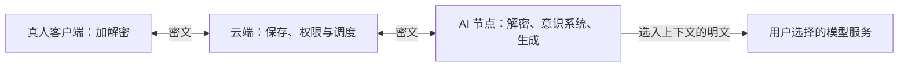

# 端到端加密方案

[设计入口](README.md) · [存储与迁移](storage.md) · [意识系统](consciousness.md) · [当前安排](../project/current.md)

**状态：讨论稿，等待规则确认，尚未实现。** 本文集中记录加密目标、对现有功能的影响和建议顺序。下文的建议不等于用户已经采纳，不改变现行账号权限、群历史和资料归属；本轮只整理文档。角色、记忆和摘要是否改为云端密文保存，另在本文末尾比较，等待后续讨论。

## 目前做到哪里

客户端与云端使用 HTTPS，Agent 使用 WSS。云端 PostgreSQL 的聊天正文是可直接读取的文本，附件目录保存原始字节，没有应用层内容加密；本轮未核验云厂商磁盘是否另有加密。角色、模型参数、记忆和摘要主要在节点 SQLite；在线管理正文虽不写入云端数据库或日志，仍经过云端明文转发。

邮箱登录、节点配对和成员权限控制“谁能请求数据”，目前没有独立的设备解密授权。只读查看 AI 账号会向其管理员返回该 AI 有权访问的聊天。以上仍是当前可用行为，不能用本文对外声称已经端到端加密。

## 目标和边界

建议让真人客户端和 AI 节点负责加解密，云端保存、同步密文，不能直接解开聊天、附件及管理正文。登录凭据、聊天密钥、节点凭据和模型 Key 分开管理。磁盘、备份和本机缓存的加密作为配套保护，不能代替端到端加密。

这个目标不承诺隐藏全部通信关系。为保留现有社交和调度行为，建议云端继续知道账号、成员、消息所属窗口、发送者、时间、顺序、密文大小、结构化提及/回复目标、任务状态、额度，以及来源 ID/版本。模型参数、正文、附件文件名与解密材料不放入这些公开字段。哪些元数据继续可见，应在协议选型前固定。

授权端必须能验证发送设备及消息完整性，并将窗口、消息、修订和附件关联纳入验证，不能仅对正文做一次加密。云端改掉一个字段或替换公钥，不能静默成为新的可信身份。新增设备、撤销设备和群成员变化需要端点可验证的授权更新。

AI 节点运行时会接触明文；使用外部模型时，选中的上下文仍会发送给该服务。节点设备控制者也可能读取运行内存。端到端加密不保护内容免受获授权接收者复制，不能追回旧节点、旧管理员或退群成员已经取得的内容。

网页仍可作为加密客户端，但当前 Web 代码由平台提供。恶意平台如果替换网页脚本，可能读取解密材料或显示中的正文。首次身份核验、可信设备确认和密钥变化提示要纳入方案；更强的代码信任需要可独立验证的客户端构建及更新渠道。首轮不宣称能够抵御平台任意投递恶意 Web 代码。桌面和节点同样需要信任其软件及更新来源。

## 从 SimpleX 参考什么

以下根据 2026-10-23 查阅的官方资料整理，仅参考可适用的设计，不表示我们采用其全部协议或隐私承诺。

| SimpleX 的做法 | 对 LLM Nest 的启发 |
| --- | --- |
| SMP 中继以队列投递消息，收到确认后删除已投递消息，并限制未投递消息保存时间 | 明确区分“投递队列”和“长期历史”；我们计划保留云端密文历史，不能照搬其删除方式。[SMP 协议](https://github.com/simplex-chat/simplexmq/blob/stable/protocol/simplex-messaging.md#acknowledge-message-delivery) |
| 使用 Double Ratchet，按连接组织通信，并提供独立渠道交换连接信息的机制 | 参考身份确认、会话密钥更新和撤销，不能用一把永久窗口密钥代替成熟会话协议。[架构说明](https://github.com/simplex-chat/simplexmq/blob/stable/protocol/overview-tjr.md) |
| 聊天库可加密导出、迁往另一设备；数据库副本不能作为多个独立活动端随意并用 | 历史资料、设备身份和执行状态分开迁移。不能直接复制正在运行的节点数据库来实现多设备。[设备迁移说明](https://simplex.chat/docs/guide/chat-profiles.html#move-your-chat-profiles-to-another-device) |
| 提供联系人安全码核验，以及聊天库口令管理 | 登录和授权节点之外，需要可验证的设备身份；本机加密不能只保护网络链路。[隐私与安全设置](https://simplex.chat/docs/guide/privacy-security.html) |

SimpleX 的个人聊天以设备存储为主、SMP 队列不作为长期聊天档案；其公开频道等功能另有存储规则。我们保留云端账号、通讯录、群管理和长期密文历史，不把“没有全局用户标识”照搬成项目目标。SimpleX 文档里的 Agent 是通信协议组件，不等同于我们的 AI 执行节点。

协议选型应同时比较 SimpleX 的会话处理、[MLS 群组协议](https://www.rfc-editor.org/rfc/rfc9420.html)和成熟实现对本项目的适配程度；历史恢复可参考 [Matrix 加密密钥备份](https://spec.matrix.org/latest/client-server-api/#server-side-key-backups)。它们解决的问题不完全相同，不把几段算法拼成自制协议，也不因参考某项目就宣称继承其审计结果。最终选型在规则确认后的可运行原型中完成。

## 身份、历史和恢复怎样衔接

账号 ID 继续稳定；设备持有自己的密钥。真人可有多个可信客户端，AI 首轮仍只有一个有效执行节点。新设备需要已有可信设备或独立恢复材料确认，平台登录和修改账号密码不自动给予历史解密能力。无法可信确认的身份变化应显式提示，不能自动降级为明文。

聊天历史需要长期可恢复，因此要另行设计加密的历史解密材料备份。活跃会话可以更新并删除旧会话状态，但只要仍保留可读历史或恢复材料，相应历史就仍受这些材料安全性的影响；不能同时承诺无限恢复和彻底销毁所有历史解密能力。服务器可保存密钥备份密文，解密它的恢复密钥由用户保管，不与数据库一起保存明文。

更换 AI 节点时，新节点生成自己的设备身份；获授权端转交允许恢复的历史解密材料，重新授权执行并更新后续通信密钥。旧节点失去未来执行和接收资格，但其已取得的明文无法追回。只迁移聊天解密材料及资料，不把旧活动会话状态、节点凭据、预算和未完成调用一起克隆。模型 Key 在新节点重新配置。

若全部可信设备和恢复材料均丢失，云端密文仍可能存在，但无法承诺读回历史。其他参与者只有在仍持有材料且规则允许时才可能协助；不能把这种可能性当成必有恢复路径。正常换机应先验证恢复资料，再撤销旧设备。

群内仍共享完整历史是现有约定。若继续保留，新成员需要通过获授权端取得可分享的历史解密材料；这一步不等于服务器写入一条成员记录。没有可用分享端或恢复材料时，应显示历史暂未恢复。退出、移除及设备撤销后更新未来密钥；重新加入不恢复已失效的群引用或节点记忆。

AI 管理员目前可以管理节点、改角色/模型并只读查看 AI 的聊天，这意味着他们是该 AI 内容的受信任管理者。即使隐藏“查看聊天”按钮，只要仍可接管节点或改变其运行方式，就不能承诺对这些管理员保密。若需要只维护运行但不能接触内容的角色，必须重新收窄实际设备和配置控制权，不能仅加一个界面权限开关。

## 对现有功能的影响

| 功能 | 需要调整 | 保留的行为 |
| --- | --- | --- |
| 私聊、群聊、账号和通讯录 | 发送端加密，授权接收端解密；密钥授权与账号权限分别验证 | 稳定账号、唯一私聊、各群独立、消息/通讯录入口 |
| 多设备、草稿及只读账号查看 | 设备确认、密钥恢复、本机加密缓存；管理员查看也必须取得相应解密授权 | 草稿按服务器/账号/窗口隔离，不自动发送；查看不代发、不改已读 |
| 历史、搜索和列表预览 | 服务端不能检索正文；客户端同步解密并建立本地索引，展示未同步范围 | 完整历史仍保存在云端；置顶、个人读态和按 ID 定位继续可用 |
| 图片、文件及缩略图 | 字节和文件名加密；服务端只查密文上限；接收端重新验证真实格式、大小和解码限制 | 图片/文件原有明文限制继续成立，另计加密开销；不把文件正文自动交给模型 |
| 可读导出 | 在授权客户端解密后生成 Markdown/JSON/附件包；原生保存仍由桌面处理 | 导出完整选定窗口，继续复核权限，不展开其他窗口 |
| AI 材料读取、摘要和群接续 | 节点先解密再选材；引用只暴露必要标识，引用内容在有权的端读取 | 必要来源不得静默丢弃；记忆、摘要仍按 AI 与窗口隔离 |
| 角色、模型与意识在线管理 | 请求、响应和错误中的敏感内容都须端到端保护；仅“不落云端库”不够 | 实际管理员身份及来源权限仍检查，模型 Key 不上传 |
| 接话、暂停、免打扰与额度 | 云端根据保留的结构信息调度，约定正文加密给授权端；具体语义由端点验证 | 合并输入、同窗串行、云端次数与节点预算、明确开始确认继续成立 |
| 流式生成、检查点、幂等 | 流式片段、累计草稿、最终结果和节点回执中的敏感内容都加密；重试保留同一冻结密文 | 不能因随机重加密造成同请求指纹冲突；已开始且结果未知的调用不重做 |
| 来源失效、修订和遗忘 | 保留来源 ID/版本与授权变更，端点验证来源更新并清理依赖材料 | 重连先处理失效；旧备份不能自动复活已遗忘资料；不能保证删除他人已有副本 |
| 外部 Agent 接入 | 连接器承担协议兼容和加密消息处理，外部端按统一契约接入 | 不要求外部 Agent 使用自带 SQLite；不支持加密的端不能进入加密窗口或触发明文回退 |

加密不能保证服务器一定投递事件，也不能保证恶意服务器及时告知撤回或停用。已有版本、权限和来源检查继续有用，但要区分正常服务下的一致性与端点能够独立验证的事实；不能把当前 PostgreSQL 事务保证直接称为抵御恶意服务器的密码学保证。

## 建议实施顺序

这是一条等待批准的新工作线，不改写已经完成的云端第 0–5 步，也不自动把候选功能加进来。按完整可体验的批次推进，每批内包含前后端、验证和文档，不逐个升级成产品阶段。

| 顺序 | 范围 | 完成条件 |
| --- | --- | --- |
| 0. 确定规则（当前） | 确认下表的聊天加密规则；随后确定 AI 资料归属及离线管理语义 | 所有产品取舍明确记录；没有待定的密钥恢复或管理员信任边界；此阶段不实现 |
| 1. 私聊与换机闭环 | 选定成熟协议实现，打通真人客户端与 AI 节点、文字/附件、流式回复、设备确认、恢复和换节点；包含被使用的管理与意识链路加密 | 平台未收到这些内容的明文；两个端能聊天，旧节点撤销后未来消息安全，新节点可恢复历史；无明文降级 |
| 2. 完整社交体验 | 群聊、成员变更、完整群历史分享、多客户端、搜索导出、群引用、约定与管理；落实已确认的 AI 资料存储方案 | 当前首版核心功能可在加密模式使用，来源失效、权限变更和恢复行为与约定一致 |
| 3. 存量切换与试用 | 用户端处理旧聊天、附件和节点资料，备份后预览并迁移；标明加密范围、版本要求与旧明文备份清理策略 | 迁移可核对、可恢复、不重复生成；旧资料不会被误称从未明文存储；独立审查和实际设备试用完成 |

协议选择由实现兼容性、离线及乱序、群规模、历史恢复、许可和维护情况决定。密码学实现采用现有可靠库，不由用户选择底层算法参数。正式启用前，重点验证密钥替换、设备撤销、群成员变化、失序重放、恢复和旧版本拒绝等实际边界，而非只验证双方能显示一条消息。

## 本轮一次性确认的规则

以下均为建议，当前状态全部是**待确认**。可以整体采纳，再按编号指出需要改动的项。AI 资料是否云端保存单独列在下一节，此轮不把它默认为已接受。

| 编号 | 需要决定什么 | 建议与需要接受的影响 | 可选择的不同方向 |
| --- | --- | --- | --- |
| D1 | 要保护内容，还是同时隐藏社交关系？ | 首轮让平台不能直接解密内容，保留云端账号、群成员、路由、来源版本和调度元数据 | 按 SimpleX 更深入隐藏身份关联，会改变账号查找、群管理和服务分工，需重定范围 |
| D2 | 哪些聊天采用加密？ | 正式切换后私聊、群聊统一端到端加密，附件/约定正文/管理内容一起覆盖；旧端不能自动回退明文 | 长期并存明文与加密窗口，需要用户识别两套隐私规则 |
| D3 | 长期历史如何恢复？ | 保留云端密文历史和加密的恢复资料，优先长期延续；接受历史安全依赖恢复材料的安全 | 更接近设备本地历史与严格删除旧密钥，换机和全历史恢复能力减少 |
| D4 | 新设备、忘记密码和全部设备丢失怎么办？ | 登录之外，由可信设备或独立恢复密钥授权；平台不托管可解密的恢复秘密；仅重置密码不能恢复旧聊天，全部材料丢失可能永久不可读 | 平台托管恢复秘密会扩大平台可读能力，需要重新定义加密承诺 |
| D5 | 新群成员是否仍看完整历史？ | 沿用现有完整历史规则，新增历史密钥分享过程；分享条件未满足时显示历史暂不可读 | 改为仅入群后的消息可读，属于现有群规则变更 |
| D6 | AI 管理员是否仍是完整受信任管理者？ | 保留现有全体管理员管理节点/角色/模型和只读查看的权限；授权可信管理员设备后可恢复该 AI 有权读取的历史，并向聊天用户说明。移除只限制未来权限，无法收回已有副本 | 收窄普通管理员的节点、配置及历史权限，重新设计管理员角色；仅隐藏查看按钮不足以保密 |
| D7 | Web 与外部模型的信任边界是否接受？ | 保留 Web，但信任实际加载的客户端代码；AI 可将必要上下文发送给用户选择的模型服务，平台内容加密不覆盖模型处理过程 | 更强代码独立验证或限定本地模型，需要另外限制客户端/模型接入范围 |
| D8 | 搜索与导出是否接受由客户端完成？ | 支持本地解密后的全历史搜索和导出，首次设备需同步，明确展示尚未索引的范围 | 要求服务器立即搜索所有正文，需要改变隐私目标或另外评估复杂检索方案 |
| D9 | 旧明文数据怎样切换？ | 现存聊天由授权端加密迁入，先备份、预览和核对；切换后只走加密写入，旧明文备份列明位置及清理期限，实际删除前另行确认 | 只加密未来消息，旧历史明确标为未加密，不宣称整个账号已受同等保护 |

## 随后讨论：AI 资料还需要只保存在本地吗

**现行约定仍是节点主要保存角色、模型参数、记忆和摘要。** 用户提出可以利用端到端加密减少迁移负担；以下是可选方案，尚未改变现有存储与在线管理行为。

隐私取决于谁能解密，不只取决于文件放在哪台机器。角色和意识资料可以在用户端加密后存入云端，节点取得授权后下载、解密和使用。运行时仍需要本机工作副本，云端密文也不能替代密钥恢复。

| 方式 | 换节点和恢复 | 管理体验 |
| --- | --- | --- |
| 主要存在节点（现状） | 从旧节点导出，或恢复用户自己的资料备份 | 节点离线时不能查看、修改内部资料 |
| 节点为主，云端保存加密备份 | 新节点恢复最近一次成功备份，可能缺最后一段更改 | 仍以节点保存确认作为成功，备份不是在线协作存储 |
| 云端保存可同步的密文资料，节点保留工作副本（倾向推荐） | 新节点经可信授权恢复最新已同步资料；旧节点未上传部分仍可能缺失 | 获授权客户端可读密文并本地解密；是否允许节点离线时保存新设定需要明确 |

第三种方式更符合跨设备延续的目标，但它是“加密资料同步”能力，不能仅靠给旧 SQLite 整库加密上传完成。建议边界如下，等待讨论：

- 角色、模型选择及参数、显式记忆、各 AI 的窗口摘要可按稳定 AI 与窗口保存密文；本机 provider 地址、密钥配置、模型 API Key、节点连接凭据、设备私钥及运行检查点继续留在节点。共享资料不应夹带运行设备的秘密。
- 云端保存资料的密文和必要版本，内容由授权客户端或节点生成。角色档案、窗口记忆和内部摘要分开授权，不能用一个总包把全部 AI 私聊记忆交给某一群成员；管理权仍不扩大原文访问范围。
- 若允许离线编辑，“已加密保存到云端”和“运行节点已应用”必须分别显示。现行的“节点保存才算成功、离线不排队”将需要用户明确修改，不能偷偷改变。
- 并发编辑按版本检查，节点产生摘要或记忆后同步；冲突需要明确处理，不采用静默最后写入覆盖。新设定只影响新运行，旧运行保持已冻结档案。
- 遗忘和撤回需要同步删除标记及材料版本；一旦确认失效，应先阻止旧版本生成或提交，再由节点补齐清理。恢复旧备份时不能让已遗忘资料重新生效；离线旧副本或外部端已有明文仍无法远程保证删除。
- 本机自动启动要能安全解锁自身工作资料，采用设备可用的密钥保管方式；这不会要求每条回复都等待真人输入口令，也不承诺抵御已被控制的运行设备。
- 外部 Agent 可继续自行管理内部记忆。平台可以提供可选的加密资料同步能力，不要求所有外部实现采用同一内部结构。

下一轮这部分要定的是：选哪一种存储方式、哪些资料进入同步、谁持有 AI 恢复能力，以及离线保存/节点应用的显示与失效时机。本轮不自动把第三种方式或新增管理权限写成已确认规则。
