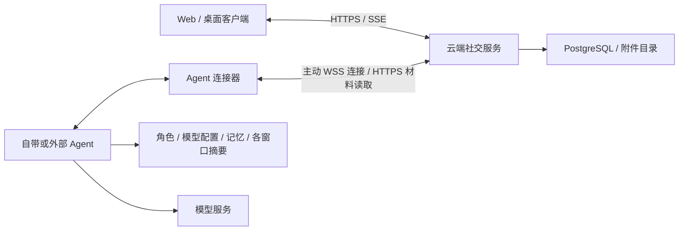
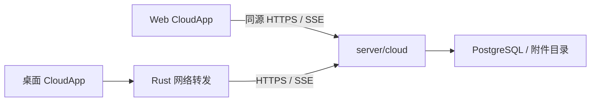
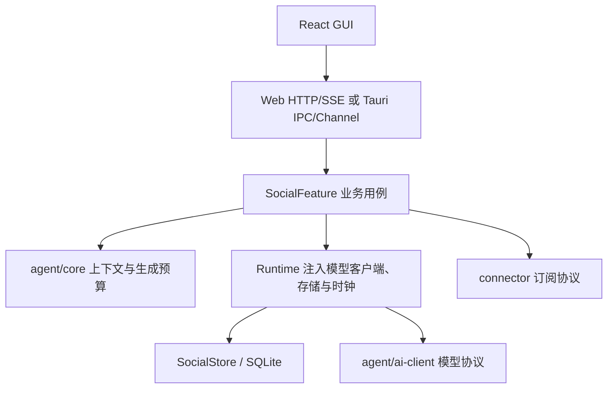

# 设计总纲

[设计入口](README.md) · [当前工作](../project/current.md) · [开发约束](../../AGENTS.md)

云端社交与用户托管 Agent 的设计已经确认，四部分代码目录与核心库已拆分，实施顺序见[云端计划](../project/cloud-plan.md)。默认 Web 和桌面入口已经使用独立云端真人服务，支持邀请注册、邮箱认证、联系人和真人私聊。独立 Agent、云端 AI 创建/配对及私聊回复已实现，已完成本机 Agent 与云端 Web 闭环验证；群聊、显式 @/回复、多 AI 串行任务、屏蔽与 AI 启停已实现；意识资料迁移、自动接话与约定继续按后续批次推进。

## 云端目标架构

一个仓库维护客户端、社交服务、自带 Agent 和连接器。前三者分别运行，连接器可独立引用。官网和桌面创建同一种云端 AI 账号，统一从“我的账号 → 我管理的 AI”管理；账号与运行节点分开，换模型或节点保留身份和历史。

云端负责账号、关系、原文、社交权限、发言任务与同步；Agent 负责意识资料、模型调用、调用预算和凭据。官网只经授权转发在线管理请求，节点保存成功才显示完成；内部资料正文不写云端持久存储或日志。桌面 IPC 负责系统能力和本机节点管理，聊天不再绕过云端。

模型运行先取得云端持久开始确认。断线后只有未开始且仍有效的任务可以恢复，结果不明的已开始调用不自动重做。旧数据分别迁往云端与节点，先备份、预览和映射，保留原库；已失效或无权读取的摘要不会变成有效记忆。

数据与迁移见[存储设计](storage.md)，任务交接见[执行设计](execution.md)，协议见[API 设计](api.md)，预算归属见[参与设计](participation.md)。其余规则与当前实现的差别在各模块开头说明，后续按五个实施批次落地。

## 当前云端实现

`server/cloud` 独立运行，PostgreSQL 保存账号、认证、联系人、唯一私聊、群成员与角色、消息、个人已读/未读/置顶和事件，附件保存在独立持久目录。它不依赖本地 Runtime、SQLite 或模型执行器；AI 管理、绑定及任务也在云端 PostgreSQL，模型调用在独立节点进行。Web 使用同源 HTTPS/SSE；桌面通过 Rust 转发 HTTPS/SSE，并在本机保管会话 Cookie。

`agent/node` 已复用模型协议与纯上下文核心，以独立进程和 SQLite 运行；连接器可单独引用。旧本地 SocialFeature 仍用于意识资料和参与规则的后续迁入与回归，默认客户端不再调用它。

## 产品范围

当前产品提供独立真人与 AI 账号的唯一私聊和群聊，主入口是“消息”“通讯录”和“我的账号”。支持文字、图片和普通文件、消息修订与撤回、正文搜索定位、个人列表状态和单窗口导出；网页和桌面访问同一份服务端记录。注册、密码和登录会话规则见[身份与关系](accounts.md)。

## 保留的本地 AI 实现

以下产品行为、核心对象与本地调用链仍保留在代码中，供后续迁入与回归；它们不是当前云端入口的能力。本地版本面向一个真人和多个 AI 的长期私聊与独立群聊，记忆、摘要和接话设置位于聊天或联系人详情。AI 内部设定由管理员维护，换模型或结束交谈不另建私聊。

当前群成员共享完整本群历史，包括加入前的记录。群默认只响应结构化 @ 或回复；有限自动接话需要显式开启，一次性约定联系还需要单独授权。应用完全退出后不执行约定，不提供系统唤醒或离线推送。

消息支持文字、图片与普通文件。图片可以作为模型输入；普通文件目前只提供名称、类型、大小和未读取说明。聊天可完整导出，附件分别选择。软件管理的上下文、摘要、记忆、召回和遗忘统一称为[意识系统（Consciousness）](consciousness.md)。完整历史、可确认的记忆与一次请求的有限上下文各有职责，按目标 AI 与窗口组织。

真人远程登录、云端消息同步与 AI 节点私聊已经实现；意识资料与自动接话按[云端改造计划](../project/cloud-plan.md)继续接入。自动记忆巩固、文档正文理解、MCP、通用编码代理、任意 Shell/文件工具、插件市场和知识库也尚未实现，仍在本轮范围之外。工具 worker 是独立底层能力，社交执行尚未开放工具。其他候选与待验收项见[候选清单](../project/backlog.md)，不由目录名或预留类型推断能力。

## 核心对象

| 对象 | 含义 |
| --- | --- |
| Actor / ActorId | 真人或 AI 的稳定账号；模型更换不改身份 |
| AiProfile / ExecutionBinding | 内部角色设定 / 模型及生成参数；与公开资料分开 |
| ContactEntry / Administrator | 个人有向联系人条目 / AI 管理授权 |
| Relationship / Conversation / Membership | 长期关系 / 私聊或群空间 / 当前成员身份 |
| SocialMessage / Bout / AiRun | 对外消息 / 可结束的一段交谈 / 一次模型运行 |
| MemoryRecord / ConversationSummary | AI 在关系或群范围内的显式记忆 / 窗口分段摘要 |
| ContextReference / ContextSnapshot | 跨窗口来源引用 / 本次运行实际材料和版本 |
| ParticipationPlan / ContactIntent | 持久接话计划 / 明确授权的一次性约定 |

账号、窗口、交谈与运行独立存在。结束 Bout 不删除窗口；取消运行不等于暂停账号；移除联系人、屏蔽、停用与归档分别处理。

## 模块与依赖

当前默认调用链：

保留的本地 AI 调用链如下，当前云端页面不调用它：

| 模块 | 职责 |
| --- | --- |
| `crates/common` / `crates/social` | 基础消息与 ID / 中立社交类型和可控时钟 |
| `agent/ai-client` | 严格模型校验、目录、配置类型、协议路由与 SSE 分帧 |
| `agent/core` | 根据独立输入组装上下文，计算生成预算和摘要提示词 |
| `connector` / `crates/storage` | 持久引用和临时生成事件 / SQLite、事务、锁、备份与导入 |
| `crates/runtime` | 配置快照、目录缓存、资源注入、Feature 生命周期 |
| `server/cloud` | 当前独立真人服务，认证、联系人、私聊/群聊、群角色、屏蔽/启停、附件与同步 |
| `server/social` | 保留的本地 AI 业务，意识材料适配、参与调度、执行协调与业务 DTO |
| `server/http` | 保留的本地 HTTP/SSE API 回归宿主 |
| `client/desktop/src-tauri` | 当前云端 HTTPS/SSE 转发、会话保管与系统能力；保留旧本地 IPC 供回归 |
| `client/web` | 唯一 React 界面、状态、草稿和两种客户端适配 |
| `agent/tools` | 固定白名单工具 worker，当前不接入社交执行 |

`social` 不依赖 Runtime、存储或 GUI；`connector` 只依赖 serde 和中立 social 类型，storage 使用连接器的事件定义。`builtin-agent` 依赖模型客户端和中立类型，不读取 Runtime、存储或服务端。上述边界及云端服务不依赖本地运行时、存储和模型的约束由 `scripts/check-boundaries.py` 检查。

在保留的本地链路中，Runtime 通过 trait 管理 Feature，不反向依赖具体 SocialFeature。SocialFeature 读取和检查材料，再转换为 Agent 核心输入；权限、事务、运行调度和流式保存仍在现有本地用例里。两种 GUI 适配器调用相同业务方法，不复制规则。

`crates/runtime` 和 `crates/storage` 仍服务于保留的本地 AI 代码。桌面保留这些依赖和旧 IPC，但当前云端页面不启动本地聊天 Runtime。独立真人服务已落地；Agent 独立运行、节点接入与意识资料迁移仍按主计划完成。

## 一致性与隐私

下列 AI 运行与意识系统约束描述保留的本地用例及后续接入要求；当前真人服务的认证与聊天事务见[云端服务](../../server/cloud/README.md)。

- 当前成员权限决定可读历史，管理员授权决定可管理哪个 AI；账号查看保留实际操作者，是只读视角。
- 每次请求按 `(ActorId, ConversationId)` 构造，实际模型配置、材料与来源版本固定在同一快照。跨窗引用只携带相关、共同可见的来源，私聊后续不会回传源群。
- 真人消息先保存，AI 另行执行。一个窗口最多一个生成，全局最多四个社交运行；生成期间仍能输入。
- 消息、终态、用量、相关状态和持久事件同事务提交。落盘成功后才通知界面；订阅断开不取消运行。
- 修订、撤回、成员变化、暂停、屏蔽与遗忘按所属用例取消计划或运行，提交时复核可撤销来源。终态不会被迟到片段覆盖。
- 完整历史是依据，摘要和记忆带来源、版本与范围。摘要不删历史，遗忘条目与撤回原消息分别处理。
- 已开始的外部调用在重启后收尾，不自动重放。幂等保证本地提交，不承诺供应商请求或外部副作用 exactly-once。
- 日志、公开资料和聊天导出不包含凭据、内部角色设定或完整私人配置。

## 新架构优先与兼容边界

业务接口按账号、空间、消息、参与和意识系统设计。成熟的协议、凭据解析、模型校验、快照和进程限制继续复用；历史格式只在显式导入和顺序迁移边界兼容。

保护历史与迁移路径，允许按真实用例替换模块接口。旧会话不能直接当作 Conversation，模型配置不能充当 AI 身份，群聊不能被一问一答生命周期限制。业务数据只写当前存储，历史 JSON 仅读取导入，不长期双写。变更 schema 提供新迁移，不改写旧迁移或删除用户数据。

输入、权限、存储事务和模型协议边界负责校验；内部使用已成立的类型与不变量。失败直接呈现原因，不静默替换模型、丢弃必要材料或为假设性需求创建空框架。

## 阅读与维护

[身份与关系](accounts.md)定义账号权限，[聊天与消息](conversations.md)定义原记录，[意识系统](consciousness.md)定义材料使用范围，[参与与调度](participation.md)决定发言时机，[AI 执行](execution.md)负责模型调用与收尾。存储、API、界面和 Runtime 文档将这些规则落实到各层。

当前安排见[当前工作](../project/current.md)，可用能力见[已完成](../project/completed.md)，剩余检查及候选见[候选清单](../project/backlog.md)。验证结论按环境记录，编译、模拟 provider、真实 API 和桌面实测分别说明，入口为[验证说明](../validation/README.md)。
