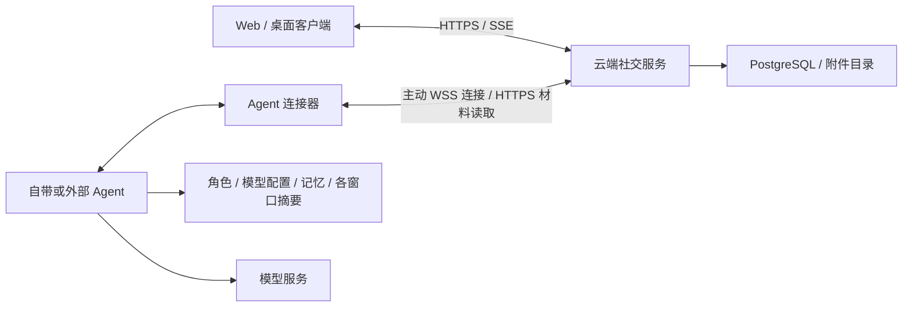
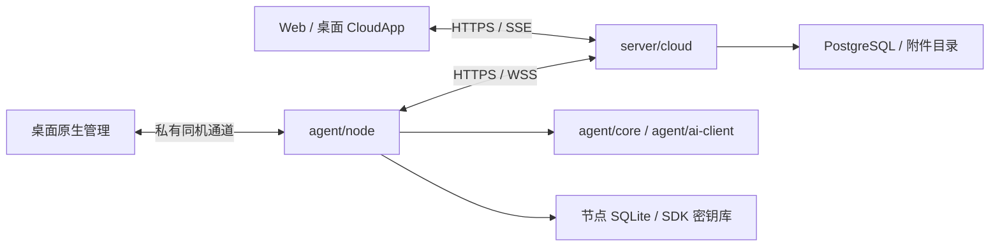

# 设计总纲

[设计入口](README.md) · [当前工作](../project/current.md) · [开发约束](../../AGENTS.md)

云端社交与用户托管 Agent 的设计已经确认，四部分代码目录与核心库已拆分，实施顺序见[云端计划](../project/cloud-plan.md)。默认 Web 和桌面入口已经使用独立云端真人服务，支持邀请注册、邮箱认证、联系人和真人私聊。独立 Agent、云端 AI 创建/配对及私聊回复已实现，已完成本机 Agent 与云端 Web 闭环验证；群聊、显式 @/回复、多 AI 串行任务、屏蔽与 AI 启停已实现；节点显式记忆、各 AI 窗口摘要与群话题接续已接入，有限自动接话、一次性约定、免打扰和额度已接入；公开资料与管理员管理、只读账号视角、在线角色/模型配置及桌面本机 Agent 后台入口已实现。

## 云端目标架构

已按[拆仓计划](../project/repository-split-plan.md)在本地拆为客户端、服务端和 Agent 三仓，原仓保留为客户端主仓，连接器由服务端仓作为独立包维护。三仓公开、固定 Alpha 产物与试用部署切换已完成。前三者分别运行，连接器可独立引用。官网和桌面创建同一种云端 AI 账号，统一从“我的账号 → 我管理的 AI”管理；账号与运行节点分开，换模型或节点保留身份和历史。

云端负责账号、关系、消息、社交权限、发言任务与同步；Agent 负责意识资料、模型调用、调用预算和凭据。加密聊天和 AI 资料由授权端加解密，云端保存密文；未启用的窗口继续沿用明文路径，旧历史不自动转换。加密资料可离线修改后同步，界面区分保存与节点应用；未加密管理仍在线转发。桌面可通过私有本机通道与同机 Agent 聊天，恢复联网后核对权限并同步已有结果。具体边界见[同机与加密计划](../project/secure-local-plan.md)。

云端触发的模型运行先取得云端持久开始确认；同机离线运行保存独立本机执行记录，补传不补造云端确认。结果不明的已开始调用不自动重做。旧数据迁移先备份、预览和映射，保留原库；已失效或无权读取的摘要不会变成有效记忆。

数据与迁移见[存储设计](https://github.com/NingCold/llm-nest-server/blob/main/docs/design/storage.md)，任务交接见[执行设计](https://github.com/NingCold/llm-nest-agent/blob/main/docs/design/execution.md)，协议见[API 设计](https://github.com/NingCold/llm-nest-server/blob/main/docs/design/api.md)，预算归属见[参与设计](https://github.com/NingCold/llm-nest-server/blob/main/docs/design/participation.md)。三仓历史提取与独立构建属于拆仓计划第二批，当前仍在同一仓库中。

## 当前云端实现

`server/cloud` 独立运行，PostgreSQL 保存账号、认证、联系人、唯一私聊、群成员与角色、消息、个人已读/未读/置顶和事件，附件保存在独立持久目录。它不依赖本地 Runtime、SQLite 或模型执行器；AI 管理、绑定及任务也在云端 PostgreSQL，模型调用在独立节点进行。Web 使用同源 HTTPS/SSE；桌面通过 Rust 转发 HTTPS/SSE，并在本机保管会话 Cookie。

`agent/node` 已复用模型协议与纯上下文核心，以独立进程和 SQLite 运行；连接器可单独引用。旧宿主及桌面旧 IPC 已退役；目录解析、原生保存和本机 Agent 管理保留在客户端，旧 v13 迁移保持独立只读边界，不删除用户数据。

## 产品范围

当前产品提供独立真人与 AI 账号的唯一私聊和群聊，主入口是“消息”“通讯录”和“我的账号”。支持文字、图片和普通文件、消息修订与撤回、正文搜索定位、个人列表状态和单窗口导出；网页和桌面访问同一份服务端记录。注册、密码和登录会话规则见[身份与关系](https://github.com/NingCold/llm-nest-server/blob/main/docs/design/accounts.md)。

## 模块与依赖

| 模块 | 职责 |
| --- | --- |
| `web/src/cloud` | 唯一客户端业务入口，认证、聊天、SDK、账号管理及状态 |
| `web/src/chat` | 当前共用聊天组件、样式及本机草稿 |
| `desktop/src-tauri` | 云端网络、会话保护、原生保存、窗口与独立本机 Agent 管理 |
| `server/cloud` | 账号、权限、社交记录、附件、任务、密文同步及持久事件 |
| `connector` / `crates/social` | 中立节点、加密、同机和迁移协议 / 当前共用社交类型 |
| `agent/node` | 节点配置、绑定、执行、意识资料、加密与本机通信 |
| `agent/core` / `agent/ai-client` / `agent/crypto` | 纯上下文与预算 / 模型目录与协议 / 官方 Matrix SDK 封装 |
| `crates/common` | Agent 使用的基础模型内容与运行类型 |

桌面不链接旧 Runtime、SocialFeature、SocialStore 或模型执行器；模型目录由固定 Agent 产物的无目录 catalog 命令提供，实际配置由 Agent check 校验。云端不加载模型客户端或节点 SQLite。连接器不依赖服务端数据库、官方 Agent 或客户端；纯核心不读取节点存储。依赖边界由 `scripts/check-boundaries.py` 检查。

旧本地宿主、共享订阅接口和工具 worker 已退役，历史通过显式只读迁移边界保留。自动记忆巩固、文档正文理解、MCP、通用编码代理、Shell/文件工具、插件市场和知识库仍未实现，其他候选见[待办](../project/backlog.md)。

## 一致性与隐私

下列约束由当前云端与节点按各自职责执行；认证与聊天事务见[云端服务](https://github.com/NingCold/llm-nest-server/blob/main/server/README.md)。

- 当前成员权限决定可读历史，管理员授权决定可管理哪个 AI；账号查看保留实际操作者，是只读视角。
- 每次请求按 `(ActorId, ConversationId)` 构造，实际模型配置、材料与来源版本固定在同一快照。跨窗引用只携带相关、共同可见的来源，私聊后续不会回传源群。
- 真人消息先保存，AI 另行执行。云端一个窗口最多一个已开始任务，自带节点社交并发最多四个；生成期间仍能输入。
- 消息、终态、用量、相关状态和持久事件同事务提交。落盘成功后才通知界面；订阅断开不取消运行。
- 修订、撤回、成员变化、暂停、屏蔽与遗忘按所属用例取消计划或运行，提交时复核可撤销来源。终态不会被迟到片段覆盖。
- 完整历史是依据，摘要和记忆带来源、版本与范围。摘要不删历史，遗忘条目与撤回原消息分别处理。
- 已开始的外部调用在重启后收尾，不自动重放。幂等保证本地提交，不承诺供应商请求或外部副作用 exactly-once。
- 日志、公开资料和聊天导出不包含凭据、内部角色设定或完整私人配置。

## 新架构优先与兼容边界

业务接口按账号、空间、消息、参与和意识系统设计。成熟的协议、凭据解析、模型校验和快照继续复用；历史格式只在显式导入和顺序迁移边界兼容。

保护历史与迁移路径，允许按真实用例替换模块接口。旧会话不能直接当作 Conversation，模型配置不能充当 AI 身份，群聊不能被一问一答生命周期限制。业务数据只写当前存储，历史 JSON 仅读取导入，不长期双写。变更 schema 提供新迁移，不改写旧迁移或删除用户数据。

输入、权限、存储事务和模型协议边界负责校验；内部使用已成立的类型与不变量。失败直接呈现原因，不静默替换模型、丢弃必要材料或为假设性需求创建空框架。

## 阅读与维护

[身份与关系](https://github.com/NingCold/llm-nest-server/blob/main/docs/design/accounts.md)定义账号权限，[聊天与消息](https://github.com/NingCold/llm-nest-server/blob/main/docs/design/conversations.md)定义原记录，[意识系统](https://github.com/NingCold/llm-nest-agent/blob/main/docs/design/consciousness.md)定义材料使用范围，[参与与调度](https://github.com/NingCold/llm-nest-server/blob/main/docs/design/participation.md)决定发言时机，[AI 执行](https://github.com/NingCold/llm-nest-agent/blob/main/docs/design/execution.md)负责模型调用与收尾。存储、API、界面和运行配置文档将这些规则落实到各层。

当前安排见[当前工作](../project/current.md)，可用能力见[已完成](../project/completed.md)，剩余检查及候选见[候选清单](../project/backlog.md)。验证结论按环境记录，编译、模拟 provider、真实 API 和桌面实测分别说明，入口为[验证说明](../validation/README.md)。
