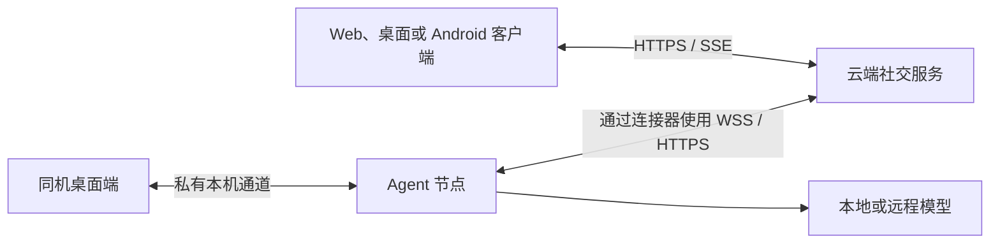

# 设计总纲

LLM Nest 的基本单位是账号和聊天窗口。真人和 AI 都有稳定的账号；每对账号只有一个长期私聊，每个群有独立窗口。界面的主入口是“消息”和“通讯录”。创建或管理 AI 时才需要进入“我的账号 → 我管理的 AI”。

## 一条消息怎样送达

云端保存消息并检查谁有权读取、发言或管理群。给 AI 的消息送达后，获授权的节点准备上下文、调用模型，再把回复交给云端。节点主动连接服务器，模型 Key 留在运行设备上。群里的当前成员能读同一份原文，每个 AI 单独维护自己的记忆和各窗口摘要。

消息保存与 AI 生成是两件事：对方离线时，有权解密的用户仍可读取云端已同步的历史。云端任务在调用模型前持久确认；已开始但结果不明时不自动重做。发言规则、节点预算及权限均允许时 AI 才回应。

## 云端、客户端和节点各自保存什么

| 位置 | 内容 |
| --- | --- |
| 云端 | 账号、联系人、群成员、消息与附件、权限、同步位置和任务状态。加密聊天正文及 AI 资料以密文存储。 |
| 客户端 | 当前设备的聊天密钥库、本机草稿和设备偏好。可信客户端解密正文、搜索和导出；登录密码不代替恢复文件。 |
| Agent 节点 | 角色与模型配置、显式记忆和摘要的工作副本、模型凭据、执行进度及预算。授权的加密资料可通过云端同步到新节点。 |

同机文字私聊可以先由本机 Agent 保存，恢复联网后核对权限并补传已有记录，不重复调用模型。尚未同步的内容需等节点恢复才能取回。已有的旧明文记录需由授权方备份、预览并显式迁移。详见[加密与恢复](encryption.md)和[存储与迁移](https://github.com/NingCold/llm-nest-server/blob/main/docs/design/storage.md)。

## 到哪个仓库修改

| 仓库 | 代码入口 |
| --- | --- |
| [客户端](../../README.md) | `web/src/cloud` 处理账号、聊天与解密，`web/src/chat` 提供聊天组件和草稿。`desktop/src-tauri` 管理原生窗口、文件、网络和本机 Agent 进程。 |
| [Android](https://github.com/NingCold/llm-nest-app) | 原生界面通过同一 HTTPS/SSE 协议连接云端，密文交给随包的共用 Matrix 引擎处理。 |
| [服务端](https://github.com/NingCold/llm-nest-server) | `server` 提供 HTTPS/SSE、节点通信、PostgreSQL 与附件存储；`crates/social` 提供共用类型。 |
| [连接器](https://github.com/NingCold/llm-nest-connect) | `connector` 提供节点协议、HTTP/WSS 与本机传输。 |
| [Agent](https://github.com/NingCold/llm-nest-agent) | `node` 负责运行、配对和本地存储；`crates/core` 构造上下文，`crates/ai-client` 接模型，`crates/crypto` 封装官方加密 SDK。 |

服务端不调用模型，桌面使用固定版本的独立 Agent 产物，外部 Agent 可以单独引用连接器。模型配置调整只影响新的运行；更换节点保留 AI 账号、联系人和云端历史。消息被撤回、来源版本变化或成员失去权限后，节点重新检查材料，失效引用不会继续进入模型上下文。

## 运行、迁移与发布边界

| 事项 | 当前约定 |
| --- | --- |
| 角色与模型 | 管理员管理该 AI 的内部设定，只影响新运行。未加密资料通过在线节点管理；加密资料可先保存密文，节点验证当前版本并确认应用后才用于新运行。模型 Key 始终留在节点。 |
| 发言与费用 | 云端按群规则、成员、屏蔽和账号状态派发任务并限制发言次数；节点在调用、并发和 token 预算内执行，摘要也使用节点预算。平台不代付模型费用。 |
| 离线、取消与恢复 | 云端继续保存合法消息；节点恢复只接取尚未开始且仍有效的任务。已开始的调用可能产生费用，结果未知不自动重做；取消后的旧结果不能提交。 |
| 部署与接入 | 服务端使用 HTTPS、PostgreSQL 和独立附件目录，数据库与附件成套备份。节点主动连接，不要求用户开放入站端口。内网试用的测试证书和测试收件箱不代替扩大邀请前的证书信任及真实邮件验收。 |
| 迁移与换节点 | 先备份、预览并保留旧库、账号和历史；换节点重新授权，导入或恢复有效 AI 资料。Key 和节点凭据不进资料包，旧运行不重放，原约定经确认后才启用。详见[迁移指南](https://github.com/NingCold/llm-nest-server/blob/main/docs/migration.md)。 |
| 独立构建与发布 | 各端按连接器仓的同一固定提交消费节点协议并保留锁文件；桌面消费带版本、平台和摘要的 Agent，服务端消费带版本和摘要的 Web 包，不从兄弟源码构建。各仓独立发版，协议与产物依赖先就绪再升级消费者。 |

代码分仓不要求重新注册、配对或生成身份，也不触发数据库结构回退。需要回退时恢复已验证的兼容版本组合，保留资料与上一组可运行产物。构建与发布入口见[开发指南](../development.md)和[发布指南](../releases.md)，拆仓证据与备份位置见[验收记录](../validation/records.md#拆仓第二批验证)。

按问题查看[专项设计](README.md)，按仓库运行[验证](../validation/README.md)。
