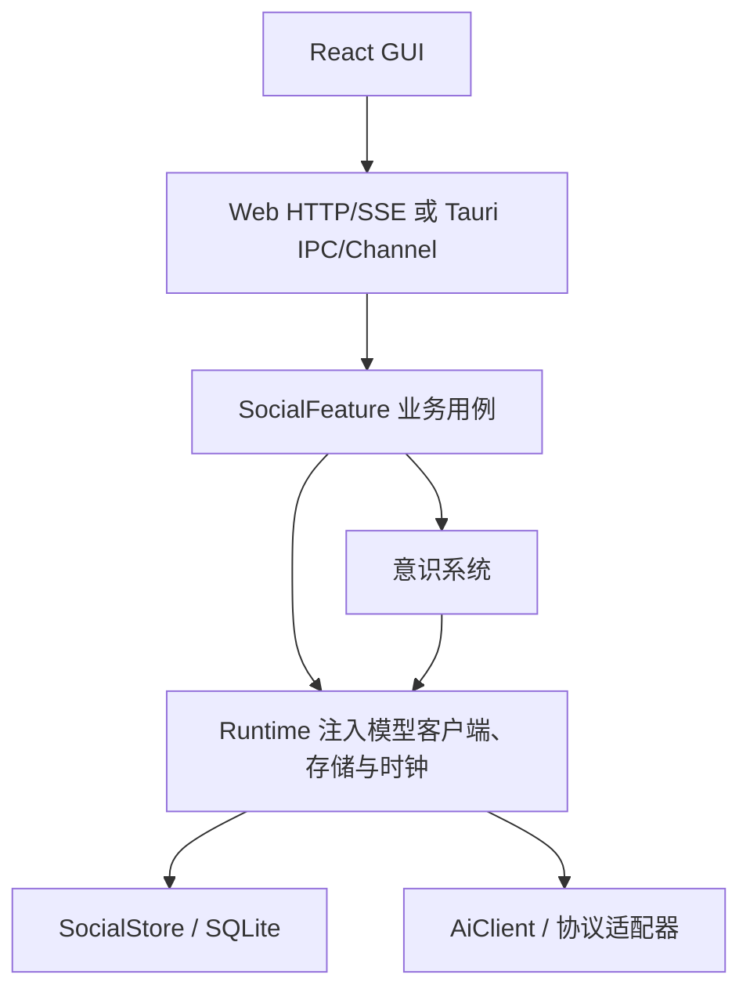

# 设计总纲

[设计入口](README.md) · [当前工作](../project/current.md) · [开发约束](../../AGENTS.md)

产品目标已调整为云端社交服务与用户托管的 Agent，正在[第 0 步](../project/cloud-plan.md#第-0-步确认顺序)确认设计。已确认单仓库的[四部分边界](../project/cloud-plan.md#已确认一个仓库四部分边界)、[Agent 保存意识资料](consciousness.md#已确认的云端重构方向)、[邀请注册与账号授权](accounts.md#已确认的云端账号方向)和[群三级权限](conversations.md#已确认的云端群管理方向)。

官网和桌面都可创建云端 AI，“我的账号 → 我管理的 AI”统一管理获授权的 AI；首轮每个 AI 使用一个有效运行节点，由管理员手动更换，详见[创建与管理入口](../project/cloud-plan.md#创建地点不同得到同一种账号)。关闭窗口后本机 Agent 默认继续后台运行，操作见[界面设计](frontend.md#已确认的云端创建与管理方向)。剩余模型管理、发言、额度、恢复、部署和迁移按[六项清单](../project/cloud-plan.md#剩余设计一次确认)集中确认。

本文以下描述现有本地实现；目标设计随确认更新，代码按实施步骤改造。

当前版本提供本地人与 AI 的社交空间。AI 有稳定账号，按允许的范围使用共同经历，并通过明确规则参与交流。Web 和 Tauri 共用 Rust 运行时与一套 React 界面。

## 产品范围

当前产品面向一个本地真人和多个 AI 的长期私聊与独立群聊。主入口是“消息”和“通讯录”；记忆、摘要和接话设置放在聊天或联系人详情，AI 内部设定由管理员在自己账号下维护。每个人与 AI 的私聊唯一，换模型、结束交谈或移除联系人均不另建窗口。

当前群成员共享完整本群历史，包括加入前的记录。群默认只响应结构化 @ 或回复；有限自动接话需要显式开启，一次性约定联系还需要单独授权。应用完全退出后不执行约定，不提供系统唤醒或离线推送。

消息支持文字、图片与普通文件。图片可以作为模型输入；普通文件目前只提供名称、类型、大小和未读取说明。聊天可完整导出，附件分别选择。软件管理的上下文、摘要、记忆、召回和遗忘统一称为[意识系统（Consciousness）](consciousness.md)。完整历史、可确认的记忆与一次请求的有限上下文各有职责，按目标 AI 与窗口组织。

远程登录、多人联网和云端消息同步尚未实现，已纳入正在确认设计的[云端改造计划](../project/cloud-plan.md)。自动记忆巩固、文档正文理解、MCP、通用编码代理、任意 Shell/文件工具、插件市场和知识库也尚未实现，仍在本轮范围之外。工具 worker 是独立底层能力，社交执行尚未开放工具。其他候选与待验收项见[候选清单](../project/backlog.md)，不由目录名或预留类型推断能力。

## 核心对象

| 对象 | 含义 |
| --- | --- |
| Actor / ActorId | 真人或 AI 的稳定账号；模型更换不改身份 |
| AiProfile / ExecutionBinding | 内部角色设定 / 模型及生成参数；与公开资料分开 |
| ContactEntry / Administrator | 个人有向联系人条目 / AI 管理授权 |
| Relationship / Conversation / Membership | 长期关系 / 私聊或群空间 / 当前成员身份 |
| SocialMessage / Bout / AiRun | 对外消息 / 可结束的一段交谈 / 一次模型运行 |
| MemoryRecord / ConversationSummary | AI 在关系或群范围内的显式记忆 / 窗口分段摘要 |
| ContextReference / ContextSnapshot | 跨窗口来源引用 / 本次运行实际材料和版本 |
| ParticipationPlan / ContactIntent | 持久接话计划 / 明确授权的一次性约定 |

账号、窗口、交谈与运行独立存在。结束 Bout 不删除窗口；取消运行不等于暂停账号；移除联系人、屏蔽、停用与归档分别处理。

## 模块与依赖

| 模块 | 职责 |
| --- | --- |
| `crates/common` / `crates/social` | 基础消息与 ID / 中立社交类型和可控时钟 |
| `crates/ai-client` | 严格模型校验、目录、配置类型、协议路由与 SSE 分帧 |
| `crates/events` / `crates/storage` | 持久引用和临时生成事件 / SQLite、事务、锁、备份与导入 |
| `crates/runtime` | 配置快照、目录缓存、资源注入、Feature 生命周期 |
| `features/social` | 账号、聊天、意识系统、参与调度、执行与共享业务 DTO |
| `crates/web-server` / `frontends/tauri/src-tauri` | HTTP/SSE 与桌面 IPC/Channel 适配 |
| `frontends/web` | 唯一 React 界面、状态、草稿和两种客户端适配 |
| `crates/tools` | 固定白名单工具 worker，当前不接入社交执行 |

`social` 不依赖 Runtime、存储或 GUI；`events` 可以依赖 social，storage 可以依赖二者。Runtime 通过 trait 管理 Feature，不反向依赖具体 SocialFeature。意识系统由 SocialFeature 内部服务承担，复用同一存储、AiClient 与 Clock。两种 GUI 适配器调用相同业务方法，不复制规则。

## 一致性与隐私

- 当前成员权限决定可读历史，管理员授权决定可管理哪个 AI；账号查看保留实际操作者，是只读视角。
- 每次请求按 `(ActorId, ConversationId)` 构造，实际模型配置、材料与来源版本固定在同一快照。跨窗引用只携带相关、共同可见的来源，私聊后续不会回传源群。
- 真人消息先保存，AI 另行执行。一个窗口最多一个生成，全局最多四个社交运行；生成期间仍能输入。
- 消息、终态、用量、相关状态和持久事件同事务提交。落盘成功后才通知界面；订阅断开不取消运行。
- 修订、撤回、成员变化、暂停、屏蔽与遗忘按所属用例取消计划或运行，提交时复核可撤销来源。终态不会被迟到片段覆盖。
- 完整历史是依据，摘要和记忆带来源、版本与范围。摘要不删历史，遗忘条目与撤回原消息分别处理。
- 已开始的外部调用在重启后收尾，不自动重放。幂等保证本地提交，不承诺供应商请求或外部副作用 exactly-once。
- 日志、公开资料和聊天导出不包含凭据、内部角色设定或完整私人配置。

## 新架构优先与兼容边界

业务接口按账号、空间、消息、参与和意识系统设计。成熟的协议、凭据解析、模型校验、快照和进程限制继续复用；历史格式只在显式导入和顺序迁移边界兼容。

保护历史与迁移路径，允许按真实用例替换模块接口。旧会话不能直接当作 Conversation，模型配置不能充当 AI 身份，群聊不能被一问一答生命周期限制。业务数据只写当前存储，历史 JSON 仅读取导入，不长期双写。变更 schema 提供新迁移，不改写旧迁移或删除用户数据。

输入、权限、存储事务和模型协议边界负责校验；内部使用已成立的类型与不变量。失败直接呈现原因，不静默替换模型、丢弃必要材料或为假设性需求创建空框架。

## 阅读与维护

[身份与关系](accounts.md)定义账号权限，[聊天与消息](conversations.md)定义原记录，[意识系统](consciousness.md)定义材料使用范围，[参与与调度](participation.md)决定发言时机，[AI 执行](execution.md)负责模型调用与收尾。存储、API、界面和 Runtime 文档将这些规则落实到各层。

当前安排见[当前工作](../project/current.md)，可用能力见[已完成](../project/completed.md)，剩余检查及候选见[候选清单](../project/backlog.md)。验证结论按环境记录，编译、模拟 provider、真实 API 和桌面实测分别说明，入口为[验证说明](../validation/README.md)。
