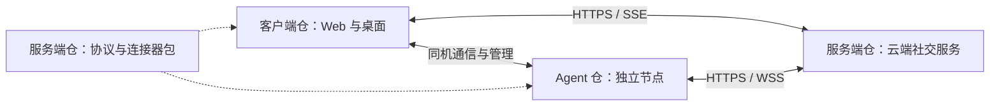

# 客户端、服务端与 Agent 拆仓计划

[当前安排](current.md) · [设计总纲](../design/overview.md) · [开发约定](../../AGENTS.md)

状态：第三批进行中。本地三仓已统一放在 llm-nest 父目录，分别为 llm-nest、llm-nest-server、llm-nest-agent；父目录本身不是 Git 仓库。两份新公开仓已创建，服务端协议提交已推送并通过 GitHub CI。三仓统一采用 Apache-2.0，正在核对发布包与第三方声明。

## 拆成什么

| GitHub 仓库 | 负责什么 | 交付什么 |
| --- | --- | --- |
| `NingCold/llm-nest` | Web 与桌面客户端、账号和聊天界面、本机解锁、桌面窗口与 Agent 管理 | Web 静态文件、Windows/Linux 桌面安装包 |
| `NingCold/llm-nest-server` | 云端账号、关系、群权限、消息和附件、任务调度、密文同步；维护公开接口和连接器 | 服务端镜像、部署工具、可独立引用的协议与连接器包 |
| `NingCold/llm-nest-agent` | 模型接入、意识系统、节点加解密、执行记录和预算、本机通信 | 独立 `llmn-agent` 程序及各平台发布包 |

三个仓库均公开。原仓保留名称、地址和完整 Git 历史，继续作为产品入口；不改名、不归档。服务端和 Agent 是新仓库，提取各自相关代码的历史，不从空白快照重新开始。

Web 与桌面继续共用界面。桌面安装包仍附带官方 Agent，用户照常创建 AI、配置和启动本机节点，不必自行下载三个项目。独立运行 Agent 的用户可以只下载 Agent。服务端部署使用客户端构建好的 Web 文件，不再从服务端源码里编译前端。

连接器仍是独立模块和可复用包，暂放服务端仓库维护，不另建第四个仓库。它不依赖服务端数据库、官方 Agent 或客户端；外部 Agent 可以只用连接器，也可以直接实现协议。



拆仓调整代码归属和构建方式，账号、聊天、可信设备、恢复材料及数据存放规则继续沿用。它不要求用户重新注册、配对或生成加密身份。

## 代码怎样归位

下表按拆分设计时的路径记录归属，供第二批追溯历史；旧宿主目录已在第一批退役。

| 设计时的路径 | 拆分后的归属 | 要处理的内容 |
| --- | --- | --- |
| `web`、`desktop` | 客户端 `web/`、`desktop/` | 保留共用 UI、草稿、网络转发、原生保存、SDK 与登录材料；去掉旧宿主接口 |
| `assets/branding`、图标生成及桌面打包脚本 | 客户端 | SVG 仍只有一份编辑源；其他仓如需图标，使用带版本的派生文件 |
| `server/cloud` | 服务端 `server/` | 包括 PostgreSQL 迁移和部署配置；附件持久目录不变 |
| `connector` | 服务端 `connector/` | 独立包，包含节点、密文封装、同机通信和迁移契约 |
| `crates/social` 中实际共用的类型与规则 | 服务端 `crates/social/` | 与连接器一起维护；保留账号、窗口、附件等必要契约，清出只属于退役宿主的实现 |
| `agent/node` | Agent `node/` | 独立入口、节点 SQLite、配对与通信、执行及资料管理 |
| `agent/core`、`agent/ai-client`、`agent/crypto`、`crates/common` | Agent `crates/` 下的对应模块 | 模型协议、上下文、Rust Matrix SDK 及模型内部类型；`common` 不再当作三仓通用层 |
| `scripts/migrate_local.py` 及迁移测试、样例库 | 服务端迁移工具 | 保留只读 v13 旧库、备份预览、映射和导出节点包的能力；节点包导入由 Agent 实现 |
| `crates/runtime`、旧 `crates/storage`、`server/social`、`server/http` | 解除依赖后退役 | 留下迁移实际需要的读取能力和测试材料，不将整套旧宿主搬进新仓 |
| `agent/tools` 及旧 worker 入口 | 随旧宿主退役 | 当前云端聊天没有使用它；不因拆仓新增工具功能 |

第一批已将 `web/src/social` 中仍在使用的组件、样式、图片/文件处理及草稿移到 `web/src/chat`。旧本地状态、页面与接口已移除，草稿数据库名和按服务器/账号隔离的保存方式沿用。有效的输入、附件和草稿测试已改为验证当前页面；旧库 v1–v13 SQL 原样保存在 `server/cloud/tests/fixtures/local-v13`，继续验证 v13 导入。

每仓拥有自己的 `Cargo.toml`、锁文件、构建脚本、CI、README 和 AGENTS。客户端根 README 继续介绍产品和使用入口，并链接另外两仓；服务端 README 说明部署，Agent README 说明运行与接入。

使用指南、产品总览和总进度留在客户端；服务端维护 API、连接器、加密封装契约及部署说明；Agent 维护模型、意识系统和节点运行说明。其他仓用链接引用主要说明，不复制三份总计划。旧链接与本地路径随迁移一起修正，历史过程查 Git，不新增一套归档文档。

## 先解除的实际依赖

拆分前，桌面直接链接 `social-feature`、`runtime`、`storage` 和 `ai-client`。第一批已解除这些依赖，下面记录处理方式；三仓各自的干净构建在第二批验证。

1. **移除桌面旧 Runtime 和旧 IPC。** 保留当前云端、本机直连、文件保存和窗口功能。目录解析改为客户端内部的小模块，沿用原数据路径；不能因删掉 `storage` 就让程序找不到已有资料。
2. **模型目录由 Agent 提供。** 桌面通过随包的 `llmn-agent catalog` 取得带版本的目录，候选配置由 Agent 的 `check` 命令校验。运行模型和最终配置校验归 Agent；客户端不再包含供应商适配器，也不直接读节点数据库。
3. **桌面使用固定 Agent 产物。** `prepare-agent.mjs` 不再在仓根执行 `cargo build -p agent-node`，改为读取版本清单、取得对应平台产物并核对 SHA-256。开发时可显式指定本地已构建的产物，不隐式访问兄弟仓源码。
4. **服务端使用固定 Web 产物。** 云端 Dockerfile 不再复制整个工作区和现场生成的 `web/dist`；改为构建本仓服务，接收指定版本及摘要的 Web 包。
5. **检查真实依赖。** 三仓构建均不要求 `../另一个仓库` 存在；连接器及协议包不把服务器实现带进客户端或 Agent。现有边界检查补上桌面及构建脚本的限制。

同机直连已经使用 `CloudState`、`LocalAgentState` 和连接器协议，不需要为了保留它继续链接旧 Runtime。桌面负责启动、停止及展示；节点负责配置应用、执行和持久化。维持当前目录锁、实例标识、关闭退到后台、托盘停止及重连补传行为。

## 协议、版本和构建

接口只维护一份权威定义：节点与同机契约在连接器，客户端 HTTP/SSE 契约在服务端。共享 Rust 类型归协议包，前端类型按接口维护并用共同样例核对；不为拆仓引入一套通用代码生成框架。

首轮跨仓 Rust 依赖使用固定 Git 提交和锁文件。连接器与 `social` 等关联包固定在同一提交，不能跟随浮动 `main`，也不靠复制源码或 submodule 同步。以后确有第三方分发需求，再选择包注册表。三仓的项目代码统一采用 Apache-2.0；第三方组件保留各自许可，源码与分发包提供相应声明。

三个产品分别发版，不要求版本号相同。客户端保持现有版本递增和安装识别信息；服务端和 Agent 在各自仓库记录版本。节点 `v4`、`sealedV1` 及当前数据格式不因换仓库改号；发生实际协议变化时，再按兼容规则升级。

服务端部署目录维护一份兼容清单，记录服务端、客户端 Web、Agent 和连接器的确切版本/提交、产物摘要及协议版本。客户端另记录随安装包附带的 Agent 版本、平台与摘要。`scripts/release.py` 改为各仓内部的版本检查，不再强制三个产品同版。

| 仓库 | 本仓检查与产物 |
| --- | --- |
| 客户端 | 前端类型与行为、布局、原生 IPC、安装包；发布 Web 包与附带固定 Agent 的桌面包 |
| 服务端 | PostgreSQL、权限与任务、附件、协议、迁移和恢复；发布镜像及部署清单 |
| Agent | 模型适配、意识资料、执行预算与恢复、加密与同机通信；发布各目标平台程序 |

跨仓联调由服务端仓库的集成流程组织，读取明确的三个提交和产物版本，使用隔离数据库、临时资料和模拟模型；每仓仍能单独执行自己的检查。构建工具链按已验证版本固定，核对现有本地与 CI 的差异。依赖契约先发布，再升级消费者；跨仓改动分开提交并互相引用，先兼容新增、再切换使用方、最后移除旧接口。

新仓公开前，第二批使用测试专用的本地 Git 镜像和已核验产物完成联调，仍按提交和摘要取依赖，不使用兄弟目录的源码路径。第三批切到正式 GitHub 地址后再做干净构建；测试地址不进入最终依赖清单。这解决首次拆仓时协议包和 Agent 发布包尚不存在的问题。

正式安装包依赖可长期下载的版本产物，不能依赖临时 CI artifact 或 `latest`。三个公开仓的依赖可只读获取，首轮不配置跨仓自动写入。每仓 CI 使用自己的最小权限令牌；GitHub 的 `GITHUB_TOKEN` 权限限于所在仓库，不能当作其他仓库的发布凭据。见 [GitHub 官方说明](https://docs.github.com/en/actions/concepts/security/github_token)。

## Git 和 GitHub 怎么处理

### 当前基线

2026-10-29 只读核对：原仓为公开的 `NingCold/llm-nest`，默认分支 `main`；远端 `main` 为 `63a93deb`，本轮文档编辑前本地为 `66d816d`，领先远端 85 个提交。另有旧 `codex/linux-build-and-docs` 分支；当时本地与远端都没有 Git 标签。

工作区另有用户对 `agent/ai-client/src/catalog.rs` 的未提交修改，本轮保持原样。拆分时必须从最终确认的本地提交取代码，不能直接克隆尚未更新的 GitHub `main` 作为基线。未提交修改单独保存和交接，不偷偷混入拆仓提交，也不用 reset 或覆盖文件抹掉。

### 保留历史的方法

1. 第一批改造完成后，记录拆分基线的完整提交号和三仓文件归属；备份全部本地 Git 引用，并单独备份未提交修改。验证备份可读，不把用户数据、密钥或编译目录加进 Git。
2. 从该本地基线用 `git clone --no-local` 建立两个独立新副本，在副本中用 `git-filter-repo` 提取服务端、Agent 相关历史。原仓不做历史重写，不用强推覆盖原 `main`。
3. 提取前检查目录的历史名称与移动记录，列出现在和过去的相关路径。过滤工具不会自动跟随路径改名，不能只选今天的 `agent/` 或 `server/cloud/`。共享文件的早期提交可以出现在两个新仓的历史中，但以后代码只由归属仓维护。
4. 核对作者、时间、相关文件的早期/近期记录及最终文件内容，保存原提交到新提交的映射。过滤会改变新仓的提交号，混合提交仅保留本仓相关部分；原仓的旧提交号保持不变。方法依据 [GitHub 拆分指南](https://docs.github.com/en/get-started/using-git/splitting-a-subfolder-out-into-a-new-repository)及 [git-filter-repo 手册](https://github.com/newren/git-filter-repo/blob/main/Documentation/git-filter-repo.txt)。
5. 原仓以普通提交移走服务端、Agent 和退役代码，保留完整旧历史。工作区会变小，原仓 `.git` 仍保存这些历史；拆仓不承诺立刻缩小它。旧分支和标签留在原仓，不自动复制到新仓，也不删除。

提取和目录整理在副本完成后，才把已核对的客户端结果接回原工作区。脚本、锁文件和部署文件都要检查，不能只确认源码目录齐全。整个过程不改写数据库迁移，特别是 `0008_migration.sql` 的精确字节和校验值。

### GitHub 切换

两份新公开仓已创建，第三批按协议、Agent、客户端、服务端部署的顺序推送与验证。只推送明确的 main 和发布 tag，不推送本地 stash 或备份引用。

先核对待公开的本地历史、配置样例和产物内容，再创建两个不带自动 README/初始提交的空仓。为新仓明确设置各自 `origin`，检查 URL 后推送各自 `main`；不使用 `--mirror` 或强推原仓。原仓通过正常前进提交接上客户端结构。

原仓的 Issues、PR、已有发布记录和收藏继续保留，不批量搬迁。产品问题继续在主仓跟踪，明确的服务端/Agent 问题可以在所属仓记录并互链。每仓配置自己的 CI、Secrets、发布说明和 README；不假定 Git 历史提取会带走 GitHub 设置。普通开发仍按约定直接在各仓 `main` 提交，不强制每次建立分支或 PR；跨仓任务写明相关提交。

第一次交付按“协议与 Agent 产物 → 客户端安装包和 Web → 服务端部署”核对依赖顺序。兼容清单记录实际部署组合，保留上一组可运行产物；代码分仓和生产资料迁移是两回事，不能为了切仓清库、换身份或改变数据目录。需要回退时先恢复已验证的版本组合，不默认回退数据库结构。

## 第二批的本地结果

从 `b6c163e0ddc525b61161f9b703b071e5c14ff9bb` 提取，使用 git-filter-repo 2.47.0；原仓保留完整历史，新仓各自保留相关历史。服务端 97 个、Agent 98 个保留提交的作者和时间已逐条核对，提取后的文件与原 Git 对象一致。随后用普通提交整理目录，没有再次改写提取结果。

| 位置（相对客户端仓） | 用途 |
| --- | --- |
| `.` | 客户端主仓，最终保留 `web/`、`desktop/`、品牌资源和产品文档 |
| `../llm-nest-server` | 服务端、协议与连接器，根 workspace 为 `server`、`connector`、`crates/social` |
| `../llm-nest-agent` | Agent，根 workspace 为 `node`、`crates/common`、`crates/ai-client`、`crates/core`、`crates/crypto` |
| `../../llm-nest-split-backup-20261029` | 原仓完整 Git bundle、引用清单、工作区和暂存区补丁、模型目录原文件、历史路径及提交映射、校验证据 |

模型目录未提交修改单独保存，客户端切换时交给 Agent 仓继续保持未提交状态。原仓不把它误记为客户端功能或纳入拆仓提交。已部署的 `0008_migration.sql` 和 13 份旧 SQLite SQL 的精确字节均已核对。

客户端与 Agent 的协议依赖固定在服务端提交 `f47f9b4a99ba8602b7992b53d22bacf08534a64c`，清单和锁文件使用正式 Git URL。此提交包含独立服务端 workspace、全部协议定义及 Apache-2.0 授权；后续打包和文档提交不改变该协议内容。

第二批远端尚未启用时，本机通过备份目录中的 `protocol.git` 提供协议代码。`run-local.py` 只为子进程临时改写这个 Git 地址，不改全局配置，也不把本地路径写入 Cargo 清单。需要在新环境从本地备份构建时，例如在客户端根目录执行：

```powershell
python ../../llm-nest-split-backup-20261029/run-local.py ../llm-nest-agent cargo +stable-x86_64-pc-windows-msvc build --locked
```

三仓的构建与测试从独立干净 checkout 执行，复用的是编译缓存和固定 Git 包，不读取另一工作区源码。跨仓联调由服务端脚本接收明确的 Agent、SDK 互通程序、Web 产物，以及客户端自行编译的加密测试产物；它不再现场转译客户端源码。具体结果统一见[验证记录](../validation/README.md)。

## 执行顺序与结束条件

不为每个目录另立一批。按三个完整结果推进，每批内完成代码、验证、文档和产物整理。

| 批次 | 范围 | 结束条件 |
| --- | --- | --- |
| 0：设计（已完成） | 确认三仓职责、原仓去向、公开可见性、历史、构建与发布方式 | 本计划及现有说明一致；代码和远端未改 |
| 1：解除依赖，保留现有体验（已完成） | 在当前仓库完成上述五项依赖处理，确定协议包和目录归属，退役旧宿主，整理共享组件与迁移测试 | 桌面不链接旧 Runtime/服务用例/模型执行；Agent 可单独构建，桌面可使用指定 Agent 产物，服务端可接收指定 Web 包；关键现有行为验证通过 |
| 2：本地拆成三个可独立使用的仓库（已完成） | 备份基线、在副本提取历史、调整目录与锁文件、拆出 README/AGENTS/CI/脚本，保存提交映射 | 三份独立干净 checkout 均能构建和运行本仓检查，不借用兄弟源码；迁移文件和最终源码内容核对；组合联调通过；此时仍不推送 |
| 3：GitHub 与发布切换 | 创建并推送两新仓，原仓正常前进到客户端结构；验证远端独立构建，发布固定产物并更新部署说明 | 可从公开仓复现三端构建与兼容组合，桌面仍附带 Agent；内网部署和本机升级保留原账号及资料，旧仓入口与文档能找到各部分 |

第一批已完成：桌面使用固定 Agent 清单；服务端使用经版本和 SHA-256 核验的 Web 包及最小构建目录；旧宿主和专用入口退役，迁移能力保留。实际验证及未覆盖范围见[验证记录](../validation/README.md#拆仓第一批验证)。

第三批已获用户授权，当前继续核对固定发布产物与安装、部署组合。公开仓代码及 GitHub CI 通过不替代日常资料和实际安装验收。

每批按改动覆盖以下已有行为：云端真人/AI 私聊和群聊；桌面本机 Agent 配对、启停、后台与托盘；同机加密通信、断云接续与重连补传；原可信设备与历史解密、锁屏和登录材料；角色/记忆/摘要同步；旧 v13 资料导入。普通验证使用临时资料和模拟模型，日常安装升级另做资料核对，不增加未授权模型调用。

已有的 Linux、干净 Windows、真实客户端重启验读及独立安全审查缺口继续见[待验收](backlog.md#待验收)，不因拆仓通过自动验证就标为完成。暂缓的平台不阻塞本地结构整理，也不被称为已经验收。每批编译后按工作约定先列清单，再逐文件整理无用产物；不递归删除，保留复用缓存、当前和上一安装版本及用户资料备份。
