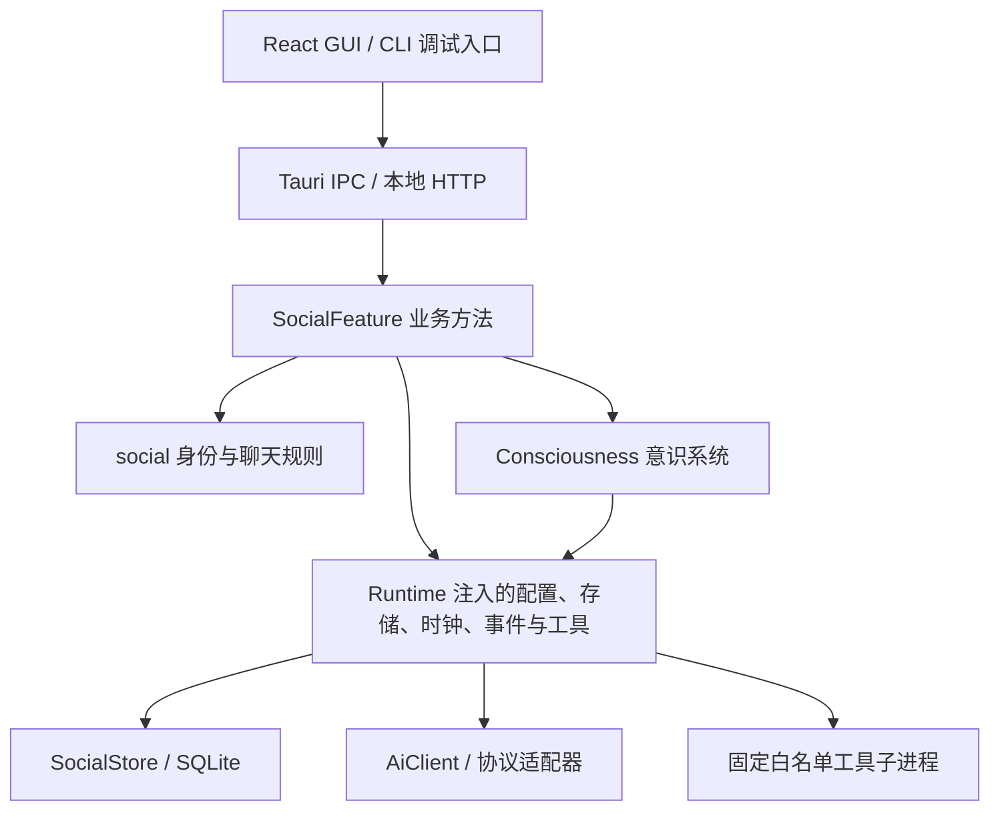

# 人与 AI 社交软件重构总纲

[文档索引](../README.md) · [当前开发约束](../../AGENTS.md)

更新日期：2026-10-13。本文维护产品范围、术语、架构边界和依赖方向。

| 文档 | 唯一职责 |
| --- | --- |
| [已完成](completed.md) / [正在推进](in-progress.md) / [尚未完成](pending.md) | 当前能力、活跃批次与剩余范围 |
| [TODO](TODO.md) | 实施顺序与完成勾选 |
| 本总纲与 01–09 专项文档 | 所属领域的设计规则；已实现字段/接口与未来扩展分别标明 |
| [交付与验证](10-delivery-and-validation.md) | 里程碑完成条件、验证场景与待细化决策 |
| M0/M1/M2/M3 批次记录 | 当时的实现和验收证据，不作为当前 API 清单或下一步计划 |
| [AGENTS](../../AGENTS.md) / [开发指南](../development.md) | 修改约束 / 环境、运行与复现命令 |

阅读时先确认状态，再查负责该规则的专项文档；当前可调用契约集中在 [API 与事件](07-api-and-events.md)。实现与设计冲突时核对调用链并同步修订，不追加“以此为准”留下旧规则。测试数量只在对应验收记录中维护，下一步只在正在推进文件维护。

## 1. 产品目标与首版范围

LLM Nest 转向人与 AI 的社交空间。核心体验是：AI 有稳定身份，记得允许使用的共同经历，并掌握参与交谈的时机与分寸。

首版明确采用“个人与多个 AI 本地私聊、群聊”的范围。AI 拥有独立账号，AI/真人账号详情的内容与结构一致，公开资料与内部设定分离；创建者成为初始管理员，可授予其他账号管理员权限。管理员从自己账号下的 AI 角色管理页面维护角色，并可登录 AI 账号查看其权限范围内的记录。移除联系人只撤下个人通讯录条目，保留私聊和共同群互动，重新添加沿用原私聊；管理员停用保留数据，恢复先只响应新消息。账号管理与关系拆分已接通，当前字段、权限与剩余细节见 [身份与关系](01-identity-and-relationships.md#0-已确认的账号与管理边界)。本批不建设账号服务器、远程登录认证、好友网络、云端同步和移动推送。应用完全退出后不执行主动联系；窗口关闭、托盘和进程退出的具体行为见界面设计。

主入口明确为“消息”和“通讯录”。记忆管理嵌入聊天详情和联系人详情，设置通过独立按钮进入，不增加第三个主入口。每个 AI 与本地真人只有一个长期私聊窗口，每个群有独立窗口；切换话题、结束交谈和更换模型均不新建私聊。

所有当前群成员共享完整本群历史，包括加入前的记录。消息可见范围由成员身份决定；意识系统按回复对象与容量选择模型上下文；参与服务决定谁在何时发言。群聊默认以 @ / 回复触发；M3 第一批已接入显式开启的有限自动接话、私聊连续输入合并、空闲结束和持久额度。

每个窗口完整保存已提交聊天记录。软件管理的上下文、摘要、记忆、召回与遗忘机制统一命名为“意识系统（Consciousness）”。它按“目标 AI + 聊天空间”选取近期消息、摘要和允许使用的记忆，逐次准备模型请求；模型的上下文容量约束每次请求，不能当作一个 AI 跨全部空间共用的永久记忆。长期记忆首版采用简单、显式、可编辑的条目，复杂后台整理留待后续。

分别构造上下文，同时支持从共同群聊接续到唯一私聊：按话题引用双方有权查看的群消息或摘要，保留来源，不合并整群记录。聊天摘要按窗口归属，可有多个分段与版本；未来角色记忆概览另行设计，参考 [OpenAI Dreaming 官方说明](https://openai.com/index/chatgpt-memory-dreaming/)，仍需保持来源与使用范围。

首个完整体验：用户创建三个 AI 联系人，分别私聊，将它们加入同一个群；消息明确归属到发送者，AI 根据规则接话，用户能够继续发送、暂停参与和结束当前交谈。关系记忆、摘要与群话题接续已接入；约定联系为 M3 下一批。

首版不扩展通用编码代理、任意 Shell/文件工具、MCP、插件市场、公开 AI 广场、语音通话或推荐信息流。现有内置工具执行能力保留，社交 AI 是否能够调用工具由显式权限控制。

M1 的新消息发送先覆盖文本。历史附件的数据保留与展示继续处理，完整附件上传、文档解析和多模态输入留待独立链路实现，不借本轮转型宣称已经支持。

## 2. Harness 基础与重构原因

重构复用已有协议路由、配置、工具进程与平台能力。下表说明保留的 Harness 结构为何需要替换；真实社交链路已经在对应模块分批实现，不表示这些问题仍存在于新 Web。

| Harness 结构 | 对新产品的影响 | 社交结构 |
| --- | --- | --- |
| Session 保存一个 ModelSelection | 模型选择承担了对话对象的职责 | AI 身份与执行配置分别建模 |
| Message 通过 user/assistant/tool 区分角色 | 无法表达多个真人或 AI 的发送者身份 | 增加独立 SocialMessage，并在调用边界转换 |
| ChatFeature 将输入与生成作为一次操作 | 默认每条输入都启动一个回答 | 发送、参与决策、生成分开 |
| 前端预建回答，使用全局 isStreaming | 不能自然接收多个空间的后台消息 | 按消息、运行和空间管理状态 |
| 编辑消息截断后续历史 | 持续群聊会丢失其他成员记录 | 消息修订与追加回应 |
| 每个会话保存整份 JSON | 跨身份、记忆、意图的事务难以管理 | SQLite 业务存储与可重复执行的迁移 |
| 请求内 SSE 负责一次回答 | 订阅断开与业务取消耦合 | 独立命令接口与可补齐事件订阅 |

源码入口：[Session](../../crates/runtime/src/session.rs)、[Message](../../crates/common/src/message.rs)、[ChatFeature](../../features/chat/src/feature.rs)、[useChat](../../frontends/web/src/hooks/useChat.ts)、[HTTP API](../../crates/web-server/src/api.rs)。

## 3. 统一术语与核心不变量

| 术语 | 定义 |
| --- | --- |
| Actor | 稳定账号与参与者，种类为 human 或 ai；ActorId 同时作为账号 ID |
| AiProfile | AI 内部角色设定与版本，仅管理员接口返回 |
| ContactEntry | 个人通讯录中的有向条目，独立于账号状态及长期私聊关系 |
| Administrator | 某 AI 账号的管理授权，含初始管理员标记 |
| ExecutionBinding | 关联同一 AI 的模型与生成配置，独立于身份档案 |
| Relationship | 两个参与者之间的关系，首版主要为真人与 AI |
| Conversation | 长期存在的私聊或群聊空间 |
| Membership | 参与者在空间中的成员身份与参与设置 |
| SocialMessage | 对外可见的社交消息，具有发送者和回复关系 |
| Bout | 一段可开始、等待和结束的交谈，不删除空间或历史 |
| AiRun | 一次 AI 生成及其工具循环，有独立 RunId |
| Consciousness | 软件管理的上下文、摘要、记忆、召回与遗忘系统 |
| MemoryRecord | 可追溯、可修订、具有使用范围的记忆 |
| ConversationSummary | 按窗口、分段与来源版本保存的历史压缩材料 |
| ContactIntent | 在授权时间或条件满足时尝试联系的持久化意图 |
| ContextScope | 目标 ActorId + ConversationId 的上下文范围，每次运行据此构造快照 |
| ContextReference | 为跨窗口接续标明来源消息/话题、目标与发起者，读取仍复核来源权限 |
| ContextSnapshot | 一次运行实际使用的背景引用与版本，包含跨窗口依赖 |

以下不变量贯穿全部专项设计：

1. ActorId 不由模型名、头像或角色提示词派生；更换模型不更换身份。
2. 私聊、群聊和关系记忆的可见范围由后端执行；召回后仍需复核权限。
3. 社交消息和 provider wire 消息分别存储与构造；发送者标签不等于协议 role。
4. 人类消息可以在 AI 生成期间持久化；一个空间首版最多一个 AI 正在生成。
5. 消息、运行终态和持久事件的相关变更在同一事务提交，成功后才通知界面。
6. 订阅中断不等于取消生成；用户停止、成员退出和权限收回可以撤销生成。
7. 暂停和结束具有确定性规则；模型不能自行绕过暂停、限额或隐私边界。
8. 自动任务只能保证本地提交的幂等性；外部模型调用和工具副作用不能宣称 exactly-once。
9. 新领域不隐式恢复任意插件能力，RuntimeEvent 不增加不存在的 Feature 变体。
10. 导入旧数据保留来源，不按相同模型名自动合并 AI 身份。
11. 一个真人与一个 AI 的私聊空间唯一，归档后恢复沿用原空间 ID；群空间分别独立。
12. 摘要或上下文裁剪不删除窗口历史；明确删除/撤回依对应业务规则处理。
13. 跨窗口接续只引用允许的相关来源，不共享 provider 续接链；私聊后续内容不自动回传源群。
14. 意识系统是统一后台服务；身份、聊天记录、参与时机、模型执行和存储各有负责模块，不增设独立聊天副本或第二个 Runtime。

## 4. 目标结构与依赖方向



`crates/social` 已在 M0 实现，`features/social` 已在 M1 接通真实私聊和群聊队列。下面列出完整目标的职责拆分；当前只有 feature、accounts、account_control、consciousness、controls、execution、wire 等实际所需模块。新 Feature 与旧 ChatFeature 在迁移期间服务各自入口；每条旧调用链随后接入同一社交用例或明确退役，避免长期维护两套聊天规则。

```text
crates/social/src/
  identity.rs       # Actor、档案、关系、执行配置的中立描述
  conversation.rs   # 空间、成员、历史访问和交谈状态
  message.rs        # 社交消息、内容、回复与修订
  consciousness.rs  # 记忆、摘要、范围、来源引用与上下文快照类型
  participation.rs  # 确定性的参与规则与决策结果
  run.rs            # 独立运行、意识系统快照引用和中断状态
  intent.rs         # 主动联系意图与状态

features/social/src/
  feature.rs        # 生命周期与对前端暴露的业务方法
  identity.rs       # 档案与关系用例
  conversations.rs  # 空间、成员与消息用例
  consciousness/
    mod.rs          # ConsciousnessService，统一协调背景准备与记忆管理
    context.rs      # ContextBuilder，为目标 AI 和空间准备上下文
    recall.rs       # 近期历史、显式来源与有效记忆筛选
    summary.rs      # 窗口分段摘要与来源视图
    reference.rs    # 群话题引用预览与权限复核
    memory.rs       # 简单记忆条目、修订与遗忘
  participation.rs  # 事件触发的参与决策与队列
  scheduler.rs      # 持久意图的领取、执行与恢复
  execution.rs      # 模型/工具循环与运行收尾
```

目录按实际职责与规模拆分，不为未来功能创建空模块。Cargo 包名已采用 `social` 与 `social-feature`。当前意识实现为单文件 `consciousness.rs`，后续按需求拆为目录。

ConsciousnessService 是 SocialFeature 内部服务，不另建 consciousness Cargo 包或独立 Feature。M1 交付近期上下文，M2 按显式记忆 → 窗口分段摘要 → 跨窗口接续分批交付；后续后台巩固沿此边界扩展，不提前创建空“做梦”模块。

依赖约束：`social` 仅依赖基础类型和序列化等通用库，不依赖 runtime、storage、ai-client 或前端；`events` 可以依赖 social；`storage` 可以依赖 social 与 events；`runtime` 注入这些资源；`social-feature` 依赖 runtime 并实现用例。runtime 不反向依赖具体 Feature，防止循环依赖。

SocialStore 的接口放在 `crates/storage`，供用例调用类型化的原子操作。共享业务 DTO 与事件序列化放在 Rust 共享模块，两条 GUI 适配只负责传输与错误映射。

## 5. 保留、改写与退出的边界

- 保留：协议适配、共享 SSE 分帧、严格模型校验、配置快照、目录同步缓存、凭据解析边界、工具子进程限制。
- 改写：聊天领域、持久化结构、运行与空间的关联、GUI 业务状态、HTTP/IPC 社交契约。
- 保留平台基线：共用 React 源码、Windows 边框与退出保存、Linux 桌面 IPC、安装标识、路径覆盖、打包资源与发布检查。当前 Windows/Linux 采用内容内窗口控制，布局与待复验范围见 [界面与桌面](08-frontend-and-desktop.md#当前真实桌面)。
- 逐步退出：旧 Session 作为新 GUI 的中心对象；旧请求内回答接口。切换前提供数据迁移，以及对应调用链的适配、替代入口或明确退役方案。
- 不扩大：未实现的 PluginManager、SDK、MCP 和知识库等预留模块。

### 新架构优先与兼容边界

以下原则已由用户确认，适用于后续各阶段：

1. **新架构优先。** SocialFeature、意识系统、参与机制和新 API 按社交领域设计。旧接口通过边界适配过渡；无法表达新语义时替换或退役，不让兼容要求反向限制业务。
2. **复用成熟能力。** 保留协议适配、凭据管理、模型校验、配置快照和工具进程等已验证能力。身份、执行绑定、关系、空间、消息、记忆和运行归属进入新的领域与存储，复用前核对实际调用链。
3. **保护数据，允许替换实现。** 保留完整历史并提供可验证的导入、备份和迁移，不要求保留旧 SessionManager、旧会话格式或旧业务流程。旧格式读取与新业务写入分离，不能为降级兼容长期双写。

具体禁止的妥协包括：把旧 Session 直接当作新 Conversation；将群聊压成一次请求一个回答；将 AI 身份寄托在全局模型配置；让旧 HTTP/IPC 的字段和生命周期决定新用例。两个 GUI 适配器调用同一业务实现，不复制社交规则。

M0 的领域类型、SocialStore 接口与 schema 是已验证的起点，可以根据真实用例继续修订；变更持久化结构时提供版本迁移。已经完成某个模块不意味着必须保留其接口。遇到冲突时，在负责该行为的模块修改实现并同步调用、文档与验收，不以零改动或旧测试全部原样通过作为架构目标；数据完整性、凭据、协议、事务收尾和平台基线继续维持。

实现时避免过分防御性编程：在输入、权限、存储和协议边界校验，内部依赖已经成立的类型与不变量。直接暴露真实失败，不重复校验、不静默回退，不为假设性需求提前创建备用机制或空模块。

## 6. 专项文档与职责

| 文档 | 核心问题 |
| --- | --- |
| [01 身份与关系](01-identity-and-relationships.md) | AI 是谁，模型更换如何影响身份，档案与关系如何管理 |
| [02 聊天与消息](02-conversations-and-messages.md) | 空间、成员、发送者、修订与交谈如何表达 |
| [03 意识系统（Consciousness）](03-consciousness.md) | 统一管理上下文、摘要、记忆、召回、来源与遗忘 |
| [04 参与与调度](04-participation-and-scheduling.md) | 谁应发言，何时等待、结束和再次联系 |
| [05 AI 执行](05-ai-execution.md) | 上下文如何转协议消息，如何保存与结束运行 |
| [06 存储与迁移](06-storage-and-migration.md) | 表、事务、锁、检查点与旧数据导入 |
| [07 API 与事件](07-api-and-events.md) | 命令、订阅、补齐、幂等与 Web/Tauri 一致性 |
| [08 界面与桌面](08-frontend-and-desktop.md) | 导航、消息状态、记忆管理与平台行为 |
| [09 运行时与配置](09-runtime-and-configuration.md) | 初始化、资源注入、配置快照、关闭与兼容 |
| [10 交付与验证](10-delivery-and-validation.md) | 里程碑、依赖顺序、验收与决策记录 |

身份与公开档案规则由 01 定义；窗口、成员与原消息由 02 定义；意识系统及材料使用范围由 03 定义；发言时机由 04 定义；模型调用和运行收尾由 05 定义。06–09 将这些规则映射到存储、双传输、界面和生命周期，10 统一交付阶段与验收。

## 7. 实施与后续决策

顺序维持 U0 → M0 → M1 → M2 → M3：先独立 Web 交互，再领域/存储基础，随后按完整业务链路接入身份与聊天、意识系统和参与节奏。每批可以跨层重写，Web 优先迭代，HTTP/IPC 调用同一 Rust 用例；Tauri 在 M1 内完成接入。

具体勾选见 [TODO](TODO.md)，拆批与完成条件见 [交付与验证](10-delivery-and-validation.md)。模型与摘要预算、实验参与参数、旧入口退出等待细化事项只在该文档的决策清单维护；多人社交与复杂后台记忆整理另行设计。
